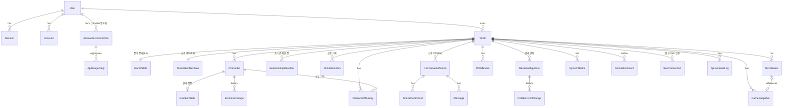

# AI Character World — 데이터베이스 설계서

> **문서 상태:** v1.4 (2026-10-27 Phase 3-1: §3.2 `defaultModel` nullable, 키 저장 구현. v1.3 Phase 2-3: §3.1 Better Auth CLI 비교 결과. v1.2 Phase 2-2 반영: §3.2 사용자당 Provider별 연결 1개. v1.1: §3.1 인증 모델, §4.3 동일 세계관 참조 무결성)
> **기준 문서:** `docs/requirements.md` (PRD v1.2), `docs/architecture.md` (결정 D1~D9, A1~A17)
> **DBMS / ORM:** PostgreSQL 16+ / Prisma
> **작성일:** 2026-10-27
> **v1.5 (2026-10-29)**: Phase 7 종료 기준 정합화 — 폐지된 LIVE/MATERIALIZED 자동저장 서술을 복구 지점(RECOVERY) 기준으로 정정(§3.6·§5.2·§5.4·§6·§7), `StatusReason`에 `NOT_ENOUGH_CHARACTERS` 반영. 스키마·마이그레이션 변경 없음.
> **진행 상태:** Phase 7 종료(2026-10-29, `e64c620`). Phase 7 마이그레이션은 7-1(20261028120000)·7-2-1(20261028140000)·7-2-2(20261028150000), 스냅샷 v4. 7-2-3·7-4는 스키마 변경 없음. 이후 캐릭터 프로필 일러스트(20261030120000, `Character.avatarId`), 스냅샷 v5. 단계별 현황은 PRD §10.1

아래 Prisma 코드 블록은 **설계 기준**이다. 실제 구현은 `prisma/schema.prisma`와 `prisma/migrations/`에 있다(Phase 2-1). 구현에서 확정된 차이는 다음과 같다.

- 모든 `DateTime`은 `@db.Timestamptz(3)`로 선언한다(§1-9). 코드 블록에서는 생략했다.
- 세계관 하위 리소스의 참조는 §4.3의 복합 FK·트리거로 같은 세계관·같은 사용자만 가리키게 한다. 코드 블록의 단일 컬럼 `@relation`은 개념 표기다.
- Prisma로 표현할 수 없는 CHECK 제약(§4.1)과 범위 트리거(§4.3)는 마이그레이션 SQL에 있다.

---

## 1. 설계 원칙

1. **세 계층 분리**: 설정(사용자 편집) / 활성 진행 상태(장면마다 커밋) / 스냅샷(세이브).
2. **세계관 단위 소유권**: 세계관에 속한 모든 리소스는 `worldId`를 직접 가진다. 그래서 하위 테이블도 `world.ownerId` 조건 하나로 소유권을 검증할 수 있다(비정규화 허용).
3. **세계관 단위 직렬화 지점**: `GameState` 행 1개다. 장면 커밋·저장·불러오기·초기화·기록 삭제는 모두 이 행을 `FOR UPDATE`로 잠근다.
4. **방향성 관계**: `(fromCharacterId, toCharacterId)` 유일. A→B와 B→A는 서로 다른 행이다.
5. **기억은 소유자 1명**: 공유된 사건도 목격자마다 별도 행을 만든다(`shareGroupId`로 묶음). 컨텍스트 조회가 `ownerCharacterId = ?`만으로 정보 비대칭을 보장한다.
6. **소프트 삭제는 Character에만**: 과거 대사 보존을 위해서다(PRD FR-04). 나머지는 실제 삭제한다.
7. **스냅샷은 독립 JSONB**: 활성 테이블과 외래 키로 엮지 않는다. 그래서 기록 삭제·초기화·세계관 편집이 세이브에 영향을 주지 않는다(D9).
8. **ID**: 문자열 ID(cuid 계열). outbox만 순서 보장을 위해 `BigInt` autoincrement를 쓴다.
9. **시간**: 모든 `DateTime`은 UTC(`timestamptz`)로 저장한다. 예외로 일일 사용량의 날짜(`ApiUsageDaily.usageDate`)만 Asia/Seoul(KST) 기준 날짜로 계산해 저장한다(A9).

---

## 2. ERD (요약)



계층별 분류:

| 계층 | 테이블 |
|---|---|
| 인증 | User, Session, Account, Verification |
| BYOK·사용량 | AiProviderConnection, ApiUsageDaily |
| 설정 | World, Character, RelationshipBaseline (+ GameState의 실행 설정 컬럼) |
| 활성 진행 상태 | GameState, ConversationScene, SceneParticipant, Message, RelationshipState, RelationshipChange, EmotionState, EmotionChange, CharacterMemory, WorldEvent |
| 실행·관찰 | SimulationRuntime, SseConnection, SimulationRun, ApiRequestLog, SystemNotice, SimulationEvent |
| 세이브 | SaveGame, GameSnapshot |

---

## 3. 모델 상세 (Prisma 초안)

### 3.1 인증 (Better Auth)

Better Auth CLI(`generate`)가 만드는 모델을 그대로 쓰고, 앱 관계 필드만 추가한다. 아래는 개념상 필드이며, 실제 필드명과 타입은 생성 결과를 따른다.

**Phase 2-1 구현 (2026-10-27 승인)**
- `better-auth` 패키지 설치 전이므로, Better Auth **1.7.14** core의 `getAuthTables` 정의와 공식 CLI(`auth` 1.7.14) Prisma 생성 규칙을 기준으로 직접 작성했다.
  - 모델 `User`·`Session`·`Account`·`Verification`, 테이블 `@@map("user"|"session"|"account"|"verification")`
  - `@@unique([email])`, `@@unique([token])`, `Session·Account @@index([userId])`, `Verification @@index([identifier])`, User 삭제 시 Cascade
- **timestamptz 유지**: CLI 기본값은 `timestamp(3)`이지만 §1-9 정책대로 `Timestamptz(3)`를 쓴다. 어댑터 동작에는 영향이 없다.
- **`account.password`는 nullable로 유지**: Better Auth core 스키마 필드다. 이메일·비밀번호 로그인은 활성화하지 않으므로(Google OAuth 전용) 항상 NULL이다.
- **Phase 2-3 검증 작업(필수)**: Better Auth를 설치한 뒤 CLI `generate` 결과와 `prisma/schema.prisma`의 인증 모델을 비교한다. 필드·타입·nullable·UNIQUE·인덱스·FK가 일치해야 한다. 허용 차이는 timestamptz와 앱 관계 필드뿐이다. 그 밖의 차이는 새 마이그레이션으로 맞추고 이 절에 기록한다.
  - **결과 (2026-10-27, `better-auth` 1.7.14 / CLI `auth` 1.7.14)**: 임시 디렉터리에 `auth generate --output`으로 생성한 스키마와 비교했다. `@db.Timestamptz(3)`와 User의 앱 관계 필드(`providerConnections`, `worlds`, `apiRequestLogs`, `sseConnections`)를 빼면 4개 모델 모두 **차이 0건**이다. CLI가 추가로 만든 모델도 없다. 스키마 변경·마이그레이션은 필요 없었다. 비교 스크립트는 일부러 만든 차이(nullable 변경, 인덱스 삭제)를 검출하는 것으로 확인했다.
  - Better Auth 버전을 올릴 때는 같은 비교를 다시 한다.

```prisma
model User {
  id            String   @id
  name          String
  email         String   @unique
  emailVerified Boolean
  image         String?
  createdAt     DateTime
  updatedAt     DateTime

  sessions           Session[]
  accounts           Account[]            // providerId = "google" 만 사용
  providerConnections AiProviderConnection[]   // 사용자당 Provider별 1개 (§3.2)
  worlds             World[]
  apiRequestLogs     ApiRequestLog[]
}
// Session, Account, Verification: Better Auth 생성 스키마 그대로 (User 삭제 시 Cascade)
```

### 3.2 BYOK·사용량

```prisma
enum AiProvider        { GEMINI }
enum ConnectionStatus  { UNVERIFIED ACTIVE INVALID }

model AiProviderConnection {
  id                   String           @id @default(cuid())
  userId               String
  provider             AiProvider       @default(GEMINI)

  // 암호화된 키 (AES-256-GCM, AAD = userId:id)
  encryptedKey         Bytes
  keyIv                Bytes
  keyAuthTag           Bytes
  encryptionKeyVersion Int
  keyLast4             String           @db.VarChar(4)
  keyFingerprint       String                                 // HMAC-SHA256, 교체 감지용

  defaultModel         String?                                // null = 미선택 (Phase 3-1 결정, 아래 참고)
  status               ConnectionStatus @default(UNVERIFIED)
  lastVerifiedAt       DateTime?
  lastErrorCode        String?

  // 사용자 설정 한도 (D8: 키 연결 단위). null = 한도 없음
  dailyRequestLimit    Int?
  dailyTokenLimit      Int?

  // 서킷 브레이커 (키 연결 단위, 여러 세계관이 공유)
  consecutiveFailures  Int              @default(0)
  backoffLevel         Int              @default(0)
  blockedUntil         DateTime?
  blockReason          String?

  createdAt            DateTime         @default(now())
  updatedAt            DateTime         @updatedAt

  user       User            @relation(fields: [userId], references: [id], onDelete: Cascade)
  usageDaily ApiUsageDaily[]

  @@unique([userId, provider])                                // 사용자당 Provider별 1개 (Phase 2-2)
}

model ApiUsageDaily {
  connectionId        String
  usageDate           DateTime @db.Date                       // Asia/Seoul(KST) 기준 날짜 (A9)
  requestCount        Int      @default(0)
  inputTokens         Int      @default(0)
  outputTokens        Int      @default(0)
  thoughtTokens       Int      @default(0)
  unmeteredRequestCount Int    @default(0)                    // 토큰 사용량을 확인할 수 없는 요청 수 (MISSING·UNKNOWN). 토큰 합계에 포함되지 않음 (Phase 3-3)
  estimatedCostMicros BigInt   @default(0)                    // 예상 비용, 1e-6 USD 단위

  connection AiProviderConnection @relation(fields: [connectionId], references: [id], onDelete: Cascade)

  @@id([connectionId, usageDate])
}
```

- **`defaultModel` nullable (Phase 3-1 결정, 마이그레이션 `20261027120000_default_model_nullable`)**: 최초 키 등록 시 NULL로 저장하고 임의의 모델명을 넣지 않는다(A17). Phase 3-2에서 실제 Gemini 모델 목록을 확인해 사용자가 고른다. **`defaultModel`이 NULL인 연결은 Gemini 호출·시뮬레이션 실행 대상으로 쓰지 않는다**(Phase 3-2 이후 실행 전 검사에서 거부). 키 교체 시 기존 값은 유지한다.
  - **Phase 3-2 확정**: `defaultModel`은 사용자가 고른 모델에 대한 최소 생성 요청이 **성공했을 때만** 저장한다. 모델별 검증 결과를 저장하는 테이블·컬럼은 두지 않는다. 사용 가능 여부는 `status = ACTIVE` + `defaultModel IS NOT NULL`로만 판단한다(`requireUsableGeminiConnection`). 키 교체 후에는 `UNVERIFIED`라서 재검증 전까지 기존 `defaultModel`을 쓸 수 없다. 재검증 때 새 키의 모델 목록에 없으면 NULL로 비운다.
  - `ApiRequestLog`: 연결 관리용 호출(검증·목록·모델 확인)은 `worldId`·`runId` 없이 기록한다. `model`은 모델 ID 또는 `(models.list)`이다. `errorMessage`에는 Google 오류의 `status`·`reason` 열거형 토큰만 저장한다. 이 행 수가 사용자별 호출 한도(10분 10회)의 집계 기준이다.
- **키 저장 구현 (Phase 3-1)**: `src/server/crypto/provider-key-crypto.ts`(AES-256-GCM)와 `src/server/domain/providers/gemini-connection.ts`.
  - 연결 id는 암호화 AAD(`userId:id`)에 쓰이므로 앱이 먼저 만든다(UUID). 교체 시 같은 행·같은 id를 유지한다.
  - `keyLast4` = 원문 끝 4자, `encryptionKeyVersion` = 1.
  - 등록·교체는 `user` 행 `FOR UPDATE`로 같은 사용자의 요청을 직렬화한다. `(userId, provider)` UNIQUE가 2차 방어다.
  - 등록·교체 직후 상태는 `UNVERIFIED`이고 `lastVerifiedAt`·`lastErrorCode`는 비운다. 실제 키 검증(ACTIVE/INVALID 전환)은 Phase 3-2에서 한다.
- **연결 단위 (Phase 2-2 확정)**: 사용자당 **Provider별** 연결 1개다(`@@unique([userId, provider])`). `User` ↔ `AiProviderConnection`은 1:N이다. 현재 Provider는 `GEMINI`만 있으므로 실제로는 사용자당 Gemini 연결 1개다. 다른 Provider는 PRD 후속 확장이며 enum 값과 구현을 함께 추가할 때까지 만들지 않는다.
- **키 조회**: 연결은 항상 `(userId = world.ownerId, provider)`로 찾는다. `userId`만으로 하나를 고르는 코드를 쓰지 않는다.
- **사용량·로그는 연결 단위**: `ApiUsageDaily(connectionId, usageDate)`, `ApiRequestLog.connectionId`는 연결(=사용자·Provider)을 가리키므로 연결 수 가정이 없다. 한도·서킷 브레이커도 연결 행의 컬럼이라 Provider별로 독립이다(D8).
- **API 응답 시 제외할 필드**: `encryptedKey`, `keyIv`, `keyAuthTag`, `keyFingerprint`. 응답 DTO에서 화이트리스트 방식으로만 필드를 고른다.
- **키 교체**(D8): 같은 행에서 암호문·`keyLast4`·`keyFingerprint`를 갱신하고 서킷 브레이커 필드(`consecutiveFailures`, `backoffLevel`, `blockedUntil`, `blockReason`)만 초기화한다. 사용자가 설정한 `dailyRequestLimit`·`dailyTokenLimit`과 `ApiUsageDaily` 집계는 유지한다.
- **KST 날짜 계산**: 앱에서 `Intl` 또는 SQL `(now() AT TIME ZONE 'Asia/Seoul')::date`로 계산한다. 한 요청 안에서 예약과 누적에 같은 날짜 값을 쓴다.
  - **Phase 3-3 구현**: `src/server/engine/usage/kst.ts`가 UTC+9 고정 오프셋으로 계산한다(KST는 서머타임 없음). `kstDate(now)`는 `@db.Date`에 넣을 값(그 KST 날짜의 UTC 자정 Date)을 돌려준다. 저장 시각(`createdAt`, `startedAt` 등 `timestamptz`)은 UTC 그대로다.
- **사용량 계측 (Phase 3-3, 마이그레이션 `20261027130000_usage_metering`)**
  - 추가: `ApiOutcome.PENDING`, `ApiUsageStatus` enum, `ApiRequestLog.usageStatus`, `ApiUsageDaily.unmeteredRequestCount`. 기존 데이터는 지우지 않고 backfill했다(기존 로그로 상태와 일별 집계를 채움).
  - 예약: Gemini로 HTTP 요청 1건을 보내기 **직전에** 한 트랜잭션에서 `ApiUsageDaily.requestCount + 1`과 `ApiRequestLog(outcome = PENDING)` INSERT를 한다. 정산: 응답 후 한 트랜잭션에서 로그를 확정하고 일일 토큰·미계측 수를 누적한다(architecture.md §8.3).
  - **정합성 불변식**: 연결·KST 날짜별로 `requestCount` = 그 날짜(`createdAt`의 KST 날짜)의 로그 행 수, 토큰 합 = 로그 토큰 합, `unmeteredRequestCount` = `usageStatus IN (MISSING, UNKNOWN)` 행 수. 로그의 `createdAt`은 예약 시각이며 집계 날짜와 같은 시각 값을 쓴다. 통합 테스트 `tests/integration/usage-guard.test.ts`가 검증한다.
  - `usageStatus`: `REPORTED`(응답에 usageMetadata 있음), `MISSING`(생성 응답 200인데 usageMetadata 없음), `UNKNOWN`(생성 요청이 5xx·시간 초과·네트워크로 끝나 생성·과금 여부 불명, 또는 결과 유실), `NOT_APPLICABLE`(모델 목록·조회, 생성 전에 거부된 4xx). 생성 요청의 PENDING 행은 NULL이다.
  - 결과 유실: 예약 후 `USAGE_PENDING_STALE_MS`(5분) 넘게 정산되지 않은 행은 같은 연결의 다음 예약 때 `outcome = ABORTED`, `errorCode = RESULT_LOST`로 확정한다(생성 요청이면 `UNKNOWN`, 미계측 +1). 요청 수는 이미 집계되어 있으므로 바꾸지 않는다.
  - 로컬에서 거부되어 전송되지 않은 시도(헤더로 보낼 수 없는 키)는 예약을 되돌린다(로그 행 삭제, `requestCount − 1`).
  - 일일 한도 확인과 증가는 연결 행 `FOR UPDATE` 잠금 안에서 한다. 잠금 순서는 `user → AiProviderConnection`(키 등록·교체와 같음).
- **키 삭제**: 행을 삭제한다. 진행 중인 세계관은 다음 호출 전 검사에서 차단된다.

### 3.3 설정 계층

```prisma
enum WorldVisibility { PRIVATE PUBLIC }           // MVP: PRIVATE만 허용 (PUBLIC 미노출)
enum Gender          { MALE FEMALE NONBINARY CUSTOM UNSPECIFIED }
enum Mood            { NEUTRAL HAPPY EXCITED CALM SAD ANXIOUS ANGRY FEARFUL EMBARRASSED LONELY HOPEFUL TIRED }
enum IntervalPreset  { SLOW NORMAL FAST }         // 15s / 5s / 1s
enum StrategyMode    { STORY AGENT }              // MVP: STORY만 노출

model World {
  id               String          @id @default(cuid())
  ownerId          String
  name             String          @db.VarChar(100)
  summary          String?         @db.Text
  eraAndPlace      String?         @db.Text          // 시대/장소
  worldRules       String?         @db.Text
  currentSituation String?         @db.Text          // 선택
  worldContext     String          @default("") @db.Text   // 글자 수 제한 없음 (D6)
  visibility       WorldVisibility @default(PRIVATE)
  templateKey      String?                           // 생성 시 사용한 템플릿 (참고용)
  createdAt        DateTime        @default(now())
  updatedAt        DateTime        @updatedAt

  owner                 User                   @relation(fields: [ownerId], references: [id], onDelete: Cascade)
  gameState             GameState?
  runtime               SimulationRuntime?
  characters            Character[]
  relationshipBaselines RelationshipBaseline[]
  // … 하위 관계 생략 (모두 onDelete: Cascade)

  @@index([ownerId, updatedAt(sort: Desc)])
}

model Character {
  id                   String    @id @default(cuid())
  worldId              String
  name                 String    @db.VarChar(50)
  gender               Gender    @default(UNSPECIFIED)
  genderCustom         String?   @db.VarChar(30)    // gender = CUSTOM 일 때
  age                  Int?                          // 비우면 저장 시 자동 설정
  personalityTags      String[]                      // 태그 코드 (config 분류표), 권장 3~5개
  extraversion         Int                           // 0..100
  agreeableness        Int
  conscientiousness    Int
  emotionalStability   Int
  openness             Int
  goal                 String?   @db.Text
  characterContext     String    @default("") @db.VarChar(300)   // 코드 포인트 300자
  childhoodBackgroundId String?  @db.VarChar(64)  // 유년기 배경 프리셋 ID (Phase 7-1, 신규·수정 시 필수, 구버전 NULL 허용)
  adulthoodBackgroundId String?  @db.VarChar(64)  // 성년기 배경 프리셋 ID (19세 이상 필수, 18세 이하 NULL — CHECK character_adulthood_age)
  avatarId             String?   @db.VarChar(32)     // 프로필 일러스트 ID (config/avatars, 신규·수정 시 필수, 이전 데이터 NULL — §3.5c)
  initialMood          Mood      @default(NEUTRAL)   // 감정 초기화 기준값
  initialMoodIntensity Int       @default(50)        // 0..100
  sortOrder            Int       @default(0)
  deletedAt            DateTime?                     // 소프트 삭제
  createdAt            DateTime  @default(now())
  updatedAt            DateTime  @updatedAt

  world World @relation(fields: [worldId], references: [id], onDelete: Cascade)

  @@index([worldId, deletedAt])
}

model RelationshipBaseline {                         // 사용자가 지정한 초기 관계 (설정)
  id              String @id @default(cuid())
  worldId         String
  fromCharacterId String
  toCharacterId   String
  affinity        Int    @default(0)                 // -100..100
  trust           Int    @default(0)                 // -100..100
  respect         Int    @default(0)                 // -100..100
  familiarity     Int    @default(0)                 // 0..100

  world World     @relation(fields: [worldId], references: [id], onDelete: Cascade)
  from  Character @relation("BaselineFrom", fields: [fromCharacterId], references: [id], onDelete: Cascade)
  to    Character @relation("BaselineTo",   fields: [toCharacterId],   references: [id], onDelete: Cascade)

  @@unique([fromCharacterId, toCharacterId])
  @@index([worldId])
}
```

- **6명 상한**은 앱에서 강제한다(§6.6). 대상은 `deletedAt IS NULL`인 캐릭터다.
- **Baseline이 없는 쌍**은 기본값(전부 0)으로 시작한다.
- 성격 태그를 `String[]`로 두는 이유: 분류표가 코드 설정(`config`)에 있고, 태그 단위 조회가 필요 없기 때문이다.

### 3.4 활성 진행 상태 (D1: GameState의 진행 이력)

```prisma
enum MotiveType      { WORLD_EVENT RELATIONSHIP GOAL MIXED }
enum SceneEndReason  { RESOLVED INTERRUPTED STALEMATE TURN_LIMIT }
enum MemoryKind      { EVENT PROMISE CONFESSION CONFLICT SECRET IMPRESSION OTHER }
enum MemoryAcquisition { WITNESSED TOLD OBSERVED }
enum WorldEventKind  { INITIAL_SITUATION SCENE_OUTCOME USER_INTERVENTION }   // USER_INTERVENTION: P2
enum EventVisibility { PUBLIC PARTICIPANTS }
enum EventStatus     { ACTIVE RESOLVED }

model GameState {
  worldId          String         @id
  stateVersion     Int            @default(0)      // 펜싱 토큰: 장면 커밋·종료·불러오기·초기화 시 +1
  changeSeq        Int            @default(0)      // 게임 상태 변경 카운터: 장면 커밋·설정 수정·기록 삭제·불러오기·초기화 시 +1 (복구 지점 판정, A13)
  worldSeconds     Int            @default(0)      // 월드 누적 시간(초): RUNNING으로 실제 진행한 시간 × 36 (Phase 7-2-2, CHECK gs_world_seconds ≥ 0)
  settingsSeq      Int            @default(0)      // 설정 펜싱 카운터: 세계관·캐릭터 설정 변경·불러오기 시만 +1 (Phase 7-2-0, 속도 변경·사건 등록 제외)
  nextSceneSeq     Int            @default(1)      // 기록 삭제와 무관하게 단조 증가

  // 실행 설정 (설정 계층이지만 1:1이므로 여기 둠; 스냅샷에 포함)
  strategyMode     StrategyMode   @default(STORY)
  intervalPreset   IntervalPreset @default(NORMAL)
  maxTurnsPerScene Int            @default(6)      // 3..6
  participantsMin  Int            @default(2)
  participantsMax  Int            @default(3)
  modelOverride    String?                         // null이면 연결의 defaultModel

  lastCommittedAt  DateTime?
  updatedAt        DateTime       @updatedAt

  world World @relation(fields: [worldId], references: [id], onDelete: Cascade)
}

model ConversationScene {
  id               String         @id @default(cuid())
  worldId          String
  seq              Int                              // 세계관 내 장면 번호
  attemptId        String         @unique           // 멱등성 키
  runId            String?                          // 생성된 Run (통계용, 소유 관계 아님)
  strategyMode     StrategyMode
  model            String
  title            String         @db.VarChar(100)
  summary          String         @db.Text
  motiveType       MotiveType
  motiveRef        String?                          // WorldEvent id 등
  endReason        SceneEndReason
  contextTruncated Boolean        @default(false)   // D6 안내 근거
  createdAt        DateTime       @default(now())

  world        World              @relation(fields: [worldId], references: [id], onDelete: Cascade)
  run          SimulationRun?     @relation(fields: [runId], references: [id], onDelete: SetNull)
  participants SceneParticipant[]
  messages     Message[]

  @@unique([worldId, seq])
  @@index([worldId, createdAt(sort: Desc)])
}

model SceneParticipant {
  sceneId      String
  characterId  String
  worldId      String                               // §4.3 복합 FK용 (Phase 2-1 추가)
  alias        String @db.VarChar(3)                // 프롬프트 별칭 C1..C6 (디버깅용)
  nameSnapshot String @db.VarChar(50)

  scene     ConversationScene @relation(fields: [sceneId], references: [id], onDelete: Cascade)
  character Character         @relation(fields: [characterId], references: [id], onDelete: Cascade)

  @@id([sceneId, characterId])
  @@index([characterId, sceneId])                   // "이 캐릭터가 참가한 최근 장면" (단기 기억)
}

model Message {
  id                  String  @id @default(cuid())
  sceneId             String
  worldId             String
  turnIndex           Int
  speakerCharacterId  String?                       // 캐릭터 실제 삭제 시 null
  speakerNameSnapshot String  @db.VarChar(50)       // 삭제된 캐릭터도 표시 유지
  dialogue            String  @db.Text
  actionIntent        String? @db.Text              // Level 2 행동 의도
  emotionCue          String? @db.VarChar(40)
  createdAt           DateTime @default(now())

  scene   ConversationScene @relation(fields: [sceneId], references: [id], onDelete: Cascade)
  speaker Character?        @relation(fields: [speakerCharacterId], references: [id], onDelete: SetNull)

  @@unique([sceneId, turnIndex])
  @@index([worldId, createdAt])
}

model RelationshipState {
  id              String   @id @default(cuid())
  worldId         String
  fromCharacterId String
  toCharacterId   String
  affinity        Int                               // -100..100
  trust           Int                               // -100..100
  respect         Int                               // -100..100
  familiarity     Int                               // 0..100
  updatedAt       DateTime @updatedAt

  changes RelationshipChange[]
  // world/from/to 관계: onDelete Cascade

  @@unique([fromCharacterId, toCharacterId])
  @@index([worldId])
}

model RelationshipChange {
  id                  String   @id @default(cuid())
  worldId             String
  relationshipStateId String
  sceneId             String?                       // 기록 삭제 시 SetNull (D9)
  dAffinity           Int                           // 적용된(clamp 후) 변화량
  dTrust              Int
  dRespect            Int
  dFamiliarity        Int
  proposed            Json                          // LLM 원 제안값 (clamp 전, 디버깅·밸런스용)
  clamped             Boolean  @default(false)
  reason              String?  @db.Text
  createdAt           DateTime @default(now())

  relationship RelationshipState  @relation(fields: [relationshipStateId], references: [id], onDelete: Cascade)
  scene        ConversationScene? @relation(fields: [sceneId], references: [id], onDelete: SetNull)

  @@index([relationshipStateId, createdAt])
}

model EmotionState {
  characterId  String   @id
  worldId      String
  mood         Mood
  intensity    Int                                  // 0..100
  updatedAt    DateTime @updatedAt
  // character: onDelete Cascade
  @@index([worldId])
}

model EmotionChange {
  id             String   @id @default(cuid())
  worldId        String
  characterId    String
  sceneId        String?                            // SetNull (D9)
  fromMood       Mood
  toMood         Mood
  dIntensity     Int
  proposedDelta  Int
  clamped        Boolean  @default(false)
  createdAt      DateTime @default(now())

  @@index([characterId, createdAt])
}

model CharacterMemory {
  id               String            @id @default(cuid())
  worldId          String
  ownerCharacterId String                           // 이 기억을 "아는" 단 한 명
  aboutCharacterId String?                          // 인물 기억 대상 (SetNull)
  kind             MemoryKind
  acquisition      MemoryAcquisition @default(WITNESSED)
  content          String            @db.Text       // ≤ 300자 (앱 검증)
  importance       Int                              // 1..5
  sourceSceneId    String?                          // 출처 장면, 기록 삭제 시 SetNull (D9)
  shareGroupId     String?                          // 같은 사건을 공유한 목격자들의 기억 묶음
  createdAt        DateTime          @default(now())

  owner Character @relation("MemoryOwner", fields: [ownerCharacterId], references: [id], onDelete: Cascade)
  about Character? @relation("MemoryAbout", fields: [aboutCharacterId], references: [id], onDelete: SetNull)

  @@index([ownerCharacterId, importance(sort: Desc), createdAt(sort: Desc)])
  @@index([worldId])
}

model WorldEvent {
  id            String          @id @default(cuid())
  worldId       String
  kind          WorldEventKind
  title         String          @db.VarChar(100)
  description   String          @db.Text
  visibility    EventVisibility @default(PUBLIC)
  status        EventStatus     @default(ACTIVE)
  sourceSceneId String?                             // SetNull
  createdAt     DateTime        @default(now())
  resolvedAt    DateTime?

  @@index([worldId, status])
}
```

**PRD 기억 분류와의 대응**

| PRD 분류 | 저장 위치 |
|---|---|
| 단기 기억 | 별도 테이블 없음. `SceneParticipant(characterId)` → 최근 장면 → `Message`로 조회한다(그 캐릭터가 참가한 장면만) |
| 장기 기억 | `CharacterMemory`, kind = EVENT·PROMISE·CONFESSION·CONFLICT·SECRET·OTHER |
| 인물 기억 | `CharacterMemory`, `aboutCharacterId` 지정(주로 IMPRESSION) |

**pgvector**: 규모가 커지면 `CharacterMemory`에 임베딩 컬럼을 추가하는 방향으로 검토한다(PRD FR-08). MVP에서는 명시적 조회 규칙만 쓴다.

### 3.5 실행·관찰

```prisma
enum RuntimeStatus { IDLE RUNNING PAUSING PAUSED }
enum StatusReason  { USER CLIENT_DISCONNECTED USAGE_LIMIT KEY_INVALID LOADED RESET SERVER_RECOVERY NOT_ENOUGH_CHARACTERS }   // NOT_ENOUGH_CHARACTERS: Phase 7-2-2 (생존자 2명 미만)
enum ApiOutcome    { SUCCESS HTTP_ERROR NETWORK_ERROR VALIDATION_ERROR ABORTED PENDING }   // PENDING: 예약됨·응답 대기 (Phase 3-3)
enum ApiUsageStatus { REPORTED MISSING UNKNOWN NOT_APPLICABLE }                           // 토큰 사용량 상태 (Phase 3-3)

model SimulationRuntime {
  worldId           String        @id
  status            RuntimeStatus @default(IDLE)
  statusReason      StatusReason?
  currentRunId      String?
  leaseOwner        String?                          // hostname:pid:bootId
  leaseExpiresAt    DateTime?
  inFlightAttemptId String?
  inFlightStartedAt DateTime?
  clientHoldSince   DateTime?                        // 활성 SSE 연결 0 → 신규 호출 보류 시작 시각 (D4)
  nextSceneAt       DateTime?                        // 다음 장면 예정 시각 (UI 표시)
  updatedAt         DateTime      @updatedAt

  world World @relation(fields: [worldId], references: [id], onDelete: Cascade)

  @@index([status, leaseExpiresAt])                  // 복구 스위퍼
}

model SseConnection {                                 // 활성 SSE 연결 등록부 (A12)
  id          String   @id @default(cuid())
  worldId     String
  userId      String
  instanceId  String                                 // 웹 인스턴스 (hostname:pid:bootId)
  connectedAt DateTime @default(now())
  lastSeenAt  DateTime @default(now())               // 10초마다 갱신, 30초 경과 시 비활성 간주

  world World @relation(fields: [worldId], references: [id], onDelete: Cascade)
  user  User  @relation(fields: [userId], references: [id], onDelete: Cascade)   // Phase 2-1: 사용자 삭제 시 고아 행 방지

  @@index([worldId, lastSeenAt])
  @@index([userId])
}

model SimulationRun {                                 // 구 PRD §7 SimulationSession → SimulationRun (A1)
  id                  String    @id @default(cuid())
  worldId             String
  startedAt           DateTime  @default(now())
  endedAt             DateTime?
  endReason           String?
  requestCount        Int       @default(0)
  successCount        Int       @default(0)
  failureCount        Int       @default(0)
  inputTokens         Int       @default(0)
  outputTokens        Int       @default(0)
  thoughtTokens       Int       @default(0)
  estimatedCostMicros BigInt    @default(0)

  world  World               @relation(fields: [worldId], references: [id], onDelete: Cascade)
  scenes ConversationScene[]

  @@index([worldId, startedAt(sort: Desc)])
}

model ApiRequestLog {
  id                  String     @id @default(cuid())
  userId              String
  connectionId        String?                        // 연결 삭제 시 SetNull
  worldId             String?
  runId               String?
  attemptId           String?
  callIndex           Int        @default(0)          // AgentMode: 장면 내 n번째 호출
  model               String
  startedAt           DateTime
  latencyMs           Int?
  httpStatus          Int?                            // NETWORK_ERROR면 null
  outcome             ApiOutcome
  errorCode           String?                         // RESOURCE_EXHAUSTED, TIMEOUT, SCHEMA_INVALID …
  errorMessage        String?    @db.VarChar(500)     // 마스킹 후 저장
  inputTokens         Int?
  outputTokens        Int?
  thoughtTokens       Int?
  usageStatus         ApiUsageStatus?                 // Phase 3-3. 사용량이 없을 때 0으로 단정하지 않는다
  estimatedCostMicros BigInt?
  createdAt           DateTime   @default(now())      // 예약 시각. 일일 집계 날짜(KST)의 기준
  // 금지: API 키, Authorization 헤더, 프롬프트·컨텍스트 원문, 응답 원문

  user  User   @relation(fields: [userId], references: [id], onDelete: Cascade)
  world World? @relation(fields: [worldId], references: [id], onDelete: Cascade)

  @@index([worldId, createdAt(sort: Desc)])
  @@index([createdAt])                                // 보관 기간 정리
}

model SystemNotice {                                  // 대화창의 시스템 메시지 (A4, 세이브 제외)
  id        String   @id @default(cuid())
  worldId   String
  runId     String?
  attemptId String?
  code      String                                    // NETWORK_ERROR / HTTP_ERROR / VALIDATION_ERROR / USAGE_LIMIT …
  message   String   @db.VarChar(500)
  createdAt DateTime @default(now())

  @@index([worldId, createdAt])
}

model SimulationEvent {                               // SSE outbox (A6)
  id        BigInt   @id @default(autoincrement())     // SSE id / Last-Event-ID
  worldId   String
  type      String
  payload   Json
  createdAt DateTime @default(now())

  @@index([worldId, id])
  @@index([createdAt])
}
```

### 3.5c 캐릭터 프로필 일러스트 (PRD v2.7, 마이그레이션 20261030120000)

- `Character.avatarId VARCHAR(32) NULL` 하나만 추가한다. 이미지 파일은 `public/characters/{avatarId}/{표정}.webp` 정적 에셋이고 DB에는 ID만 둔다. 메시지별 표정·감정 컬럼은 두지 않는다(대화창은 항상 기본 표정).
- 기존 행은 NULL로 두고 임의 배정하지 않는다(화면은 이름 첫 글자 원으로 대체 표시, 캐릭터를 수정할 때 선택).
- **같은 세계관 활성 캐릭터 중복 금지**: `createCharacter`·`updateCharacter`가 World 행 잠금(§6) 아래에서 같은 세계관의 `deletedAt IS NULL` 캐릭터(사망자 포함, 자기 자신 제외)가 같은 `avatarId`를 쓰는지 확인하고 409 `AVATAR_IN_USE`로 거절한다. 활성 6명 상한과 같은 직렬화 방식이라 동시 요청에서도 중복이 생기지 않는다. 소프트 삭제된 캐릭터는 점유하지 않는다.
- 부분 UNIQUE 인덱스(`WHERE "deletedAt" IS NULL`)는 Prisma 스키마로 표현할 수 없어(Prisma 7.10) 두지 않았다. 불러오기 복원은 같은 World 잠금 안에서 스냅샷 상태로 통째로 바뀌고, 스냅샷 검증(`snapshotV5Error`)이 활성 캐릭터 중복을 거절한다.

### 3.5b 월드 시간·신체 상태 재구성 (Phase 7-2-2, 마이그레이션 20261028150000)

- `GameState.worldSeconds`(정산된 월드 초), `SimulationRuntime.clockAnchorAt`·`clockCheckpointAt`(흐르는 중인 구간 시작·마지막 확인, 스냅샷 제외), `ConversationScene.worldSeconds`, `WorldEvent.startedWorldSeconds`·`resolvedWorldSeconds`, `CharacterConditionChange.worldSeconds`.
- `CharacterCondition`: `thermal`(ThermalState) → `thermalCause`(`ThermalCause` NONE·COLD·HEAT) + `thermalLevel`(`DiscomfortLevel` NONE·MILD·SEVERE·EXTREME, CHECK `character_condition_thermal_pair`: 원인 NONE ⇔ 단계 NONE) + `thermalSinceSeconds`. 고통 `painLevel`·`painCause`·`painSinceSeconds`(부상과 독립). `injuryUpdatedSceneSeq` → `injuryUpdatedAtSeconds`(월드 시간 기준 회복). `extremeSinceSeconds`(극심 지속 시작), `deathWorldSeconds`. `ThermalState` enum 삭제.
- 단방향 매핑: COLD·VERY_COLD → 추위 경미·심함, HOT·VERY_HOT → 더위 경미·심함, 고통 = 부상 MILD·MODERATE → 경미, SEVERE → 심함, CRITICAL → 극심(원인 = 부상 원인), 기존 부상·온도·고통·위독(극심)의 기준 시각 = 월드 0.
- `StatusReason` + `NOT_ENOUGH_CHARACTERS`(생존자 2명 미만 정지).

### 3.5a 사건·신체 상태 (Phase 7-2-1, 마이그레이션 20261028140000)

- `WorldEvent` 확장: `kind` + `RANDOM`, `status` + `PENDING`·`CANCELLED`, `presetId`, `intensity`(`EventIntensity` LOW·MEDIUM·HIGH), `requestId`(`@@unique([worldId, requestId])`), `startedSceneSeq`, `lastSceneSeq`, `resolvedSceneSeq`, `resolutionSummary`, `claimedAttemptId`, `cancelledAt`. 사용자 사건 원문은 `description`(CHECK `world_event_user_text_length` ≤ 200자).
- `WorldEventPeriod(worldId, periodIndex)` PK: `won`, `scheduledSceneSeq`(CHECK `world_event_period_schedule`: 당첨 ⇔ 예약 장면), `presetId`, `eventId`(SetNull, 트리거 `event_period_event_same_world`), `firedAt`.
- `CharacterCondition` 1:1 (`(characterId, worldId)` 복합 FK): `thermal`(`ThermalState`), `injury`(`InjurySeverity`, 통증 단계 겸용), `injuryCause`, `injurySceneSeq`, `injuryUpdatedSceneSeq`, `vital`(`VitalStatus`), `deathCause`, `deathSceneSeq`, `diedAt`. CHECK `character_condition_death_record`(사망이면 원인·장면·시각 필수), `character_condition_injury_cause`(부상이면 원인 필수). 기존 캐릭터는 마이그레이션에서 기본값 행을 만들고, 캐릭터 생성 트랜잭션이 함께 만든다.
- `CharacterConditionChange`: `kind`(`ConditionChangeKind` THERMAL·INJURY·TREATMENT·RECOVERY·DEATH), `fromValue`·`toValue`, `reason`, `sceneId`·`eventId`(SetNull, 트리거 `condition_change_scene_same_world`·`condition_change_event_same_world`), `(characterId, worldId)` 복합 FK.
- 사망은 `Character.deletedAt`과 무관하다. 사망자도 활성 슬롯(6명)에 포함된다.
- 사용자 사건(Phase 7-2-3, 스키마 변경 없음): `kind = USER_INTERVENTION`, `status = PENDING`, `intensity = MEDIUM`, `title` = 원문 앞 40자, `description` = 원문, `requestId` 멱등. 등록·취소·점유는 World 행 잠금 아래에서 하고, `claimedAttemptId`는 PENDING일 때만 값이 있으며 발생·취소·시도 종료 때 비운다. 대기 순서는 `createdAt`(30초 간격이라 등록 순과 같다).
- 사건 1회 반영(PRD v2.2, 스키마 변경 없음): 자동·사용자 사건은 발생 장면 커밋에서 `status = RESOLVED`(장면 반영 완료 — 신규 사건에서는 해결 완료가 아니다. 해결 요약이 있는 RESOLVED는 v2.2 이전 해결 기록), `startedSceneSeq = resolvedSceneSeq = lastSceneSeq`, `resolutionSummary = NULL`로 기록한다. `ACTIVE`는 v2.2 이전 기록에만 남으며 더 이상 갱신하지 않는다. 사건 기억은 기존 `CharacterMemory`를 쓰고 `shareGroupId = 사건 id`로 사건을 식별한다(모델 기억은 `eventRef`가 있으면 연결, 서버 사실 기억은 `kind EVENT`·`WITNESSED`·`sourceSceneId = 발생 장면`). 참가자 × 사건마다 하나 이상을 보장한다.

### 3.6 세이브

```prisma
enum SaveKind { MANUAL RECOVERY AUTO }               // Phase 6: 기존 AUTO(복구 지점)는 RECOVERY로 이름이 바뀌고, AUTO는 1시간 자동 저장 슬롯

model SaveGame {
  id                 String   @id @default(cuid())
  worldId            String
  kind               SaveKind
  recoveryForWorldId String?  @unique                // RECOVERY일 때만 = worldId → 세계관당 복구 지점 1개 보장
  autoSlot           Int?                             // AUTO일 때만 1..5 (고정 슬롯 번호, @@unique([worldId, autoSlot]))
  name               String   @db.VarChar(60)        // AUTO는 "{세계관} - Auto Save {n}", RECOVERY는 "복구 지점"
  snapshotId         String?  @unique                // RECOVERY + null = 아직 복구 지점 없음
  sceneCount         Int                              // 표시용 메타데이터
  characterCount     Int
  worldNameSnapshot  String   @db.VarChar(100)
  stateVersionAtSave Int
  replacedAtChangeSeq Int?                           // RECOVERY 전용: 직전 불러오기·초기화 적용 직후의 GameState.changeSeq (A13)
  createdAt          DateTime @default(now())
  updatedAt          DateTime @updatedAt

  world    World         @relation(fields: [worldId], references: [id], onDelete: Cascade)
  snapshot GameSnapshot? @relation(fields: [snapshotId], references: [id], onDelete: SetNull)

  @@unique([worldId, autoSlot])
  @@index([worldId, kind, updatedAt(sort: Desc)])
}

// SimulationRuntime.nextAutoSaveAt (Phase 6): 다음 자동 저장 예정 시각 = 마지막 성공 + 1시간 (재시작 후에도 DB 기준)

model GameSnapshot {
  id            String   @id @default(cuid())
  worldId       String
  schemaVersion Int                                   // §5.3
  payload       Json                                  // jsonb, TOAST 자동 압축
  sizeBytes     Int
  checksum      String   @db.VarChar(64)              // SHA-256 hex
  createdAt     DateTime @default(now())

  world World     @relation(fields: [worldId], references: [id], onDelete: Cascade)
  save  SaveGame?

  @@index([worldId])
}
```

- **`recoveryForWorldId` 기법** (Phase 6 전 이름 `autoForWorldId`): PostgreSQL의 UNIQUE는 NULL을 여러 개 허용한다. MANUAL·AUTO 행은 NULL, RECOVERY 행만 `worldId` 값을 가지므로, 부분 인덱스 없이 "세계관당 복구 지점 1개"를 보장한다.
- **RECOVERY 행 생성 시점**: 세계관을 만들 때 GameState·SimulationRuntime과 함께 만든다(`snapshotId = null` = 아직 복구 지점 없음). AUTO 행(1시간 자동 저장 슬롯 1~5)은 첫 자동 저장 때 만든다.
- **MANUAL 행**은 `snapshotId`가 항상 NOT NULL이다(앱에서 보장, CHECK 제약 추가).

---

## 4. 제약 조건과 인덱스

### 4.1 Prisma 스키마 밖에서 추가할 CHECK 제약 (마이그레이션 SQL)

Prisma는 CHECK를 스키마로 표현하지 않는다. 그래서 `prisma migrate dev --create-only` 후 SQL을 직접 추가한다.

```sql
ALTER TABLE "Character" ADD CONSTRAINT character_bigfive_range CHECK (
  extraversion BETWEEN 0 AND 100 AND agreeableness BETWEEN 0 AND 100 AND
  conscientiousness BETWEEN 0 AND 100 AND "emotionalStability" BETWEEN 0 AND 100 AND
  openness BETWEEN 0 AND 100 AND "initialMoodIntensity" BETWEEN 0 AND 100);
ALTER TABLE "Character" ADD CONSTRAINT character_age_range CHECK (age IS NULL OR age BETWEEN 0 AND 1000);

ALTER TABLE "RelationshipState" ADD CONSTRAINT rel_range CHECK (
  affinity BETWEEN -100 AND 100 AND trust BETWEEN -100 AND 100 AND
  respect BETWEEN -100 AND 100 AND familiarity BETWEEN 0 AND 100);
ALTER TABLE "RelationshipState" ADD CONSTRAINT rel_not_self CHECK ("fromCharacterId" <> "toCharacterId");
-- RelationshipBaseline 에도 동일

ALTER TABLE "EmotionState"     ADD CONSTRAINT emotion_range CHECK (intensity BETWEEN 0 AND 100);
ALTER TABLE "CharacterMemory"  ADD CONSTRAINT memory_importance CHECK (importance BETWEEN 1 AND 5);
ALTER TABLE "GameState"        ADD CONSTRAINT gs_turns CHECK ("maxTurnsPerScene" BETWEEN 3 AND 6
                                 AND "participantsMin" >= 2 AND "participantsMax" BETWEEN "participantsMin" AND 6);
ALTER TABLE "SaveGame"         ADD CONSTRAINT save_kind_consistency CHECK (   -- Phase 6 (20261028100100)
  (kind = 'MANUAL'   AND "recoveryForWorldId" IS NULL AND "autoSlot" IS NULL AND "snapshotId" IS NOT NULL) OR
  (kind = 'AUTO'     AND "recoveryForWorldId" IS NULL AND "autoSlot" BETWEEN 1 AND 5 AND "snapshotId" IS NOT NULL) OR
  (kind = 'RECOVERY' AND "recoveryForWorldId" = "worldId" AND "autoSlot" IS NULL));
```

- 앱 검증이 1차 방어다. clamp는 앱에서 먼저 적용하므로, CHECK 위반은 곧 버그다. 트랜잭션이 롤백되어 장면 실패로 처리된다.
- 나이 상한 1000은 판타지 종족을 고려한 기술적 상한이다. 랜덤 생성 범위는 별도(랜덤 1~80, 빈 나이 자동 19~80, PRD v2.6)이다.
- `RelationshipBaseline`에도 같은 범위·자기 참조 금지 CHECK(`baseline_range`, `baseline_not_self`)를 둔다.
- `Character`: 성년기 배경은 19세 이상만 `character_adulthood_age CHECK ("adulthoodBackgroundId" IS NULL OR "age" >= 19)` (Phase 7-1, 20261028120000). 배경 ID 값 자체(프리셋 44종)는 앱이 검증한다.
- Phase 7-2-1(20261028140000): `character_condition_death_record`, `character_condition_injury_cause`, `world_event_period_schedule`, `world_event_user_text_length` (§3.5a). 프리셋 ID 값은 앱·스냅샷 검증이 확인한다.
- Phase 7-2-2(20261028150000): `character_condition_thermal_pair`, `gs_world_seconds` (§3.5b). CHECK는 모두 17개.

### 4.2 주요 조회와 인덱스

| 조회 | 인덱스 |
|---|---|
| 내 세계관 목록 | `World(ownerId, updatedAt desc)` |
| 활성 캐릭터 | `Character(worldId, deletedAt)` |
| 대화 기록 페이지네이션 | `ConversationScene(worldId, seq)` UNIQUE (역순 스캔) |
| 캐릭터별 최근 참가 장면 (단기 기억) | `SceneParticipant(characterId, sceneId)` |
| 캐릭터 기억 선별 | `CharacterMemory(ownerCharacterId, importance desc, createdAt desc)` |
| SSE 재전송 | `SimulationEvent(worldId, id)` |
| 복구 스위퍼 | `SimulationRuntime(status, leaseExpiresAt)` |
| API 로그 탭 | `ApiRequestLog(worldId, createdAt desc)` |
| 세이브 목록 | `SaveGame(worldId, kind, updatedAt desc)` |

### 4.3 동일 세계관·동일 사용자 참조 무결성 (Phase 2-1, 2026-10-27 승인)

`worldId` 단일 FK만으로는 세계관 A의 행이 세계관 B(다른 사용자 소유일 수 있음)의 캐릭터·장면·스냅샷을 가리키는 것을 막지 못한다. 그래서 DB에서 세 가지 방법으로 막는다.

**1) 필수 참조 → `(참조 id, worldId)` 복합 FK** (`ON DELETE CASCADE ON UPDATE RESTRICT`)

대상 테이블에 `@@unique([id, worldId])`를 둔다: `Character`, `ConversationScene`, `RelationshipState` (+ `EmotionState`는 1:1이라 `@@unique([characterId, worldId])`).

| 참조하는 쪽 | 컬럼 → 대상 |
|---|---|
| RelationshipBaseline | `fromCharacterId`, `toCharacterId` → Character |
| RelationshipState | `fromCharacterId`, `toCharacterId` → Character |
| RelationshipChange | `relationshipStateId` → RelationshipState |
| EmotionState | `characterId` → Character |
| EmotionChange | `characterId` → Character |
| SceneParticipant | `sceneId` → ConversationScene, `characterId` → Character (`worldId` 컬럼 추가) |
| Message | `sceneId` → ConversationScene |
| CharacterMemory | `ownerCharacterId` → Character |
| CharacterCondition | `characterId` → Character (Phase 7-2) |
| CharacterConditionChange | `characterId` → Character (Phase 7-2) |

`ON UPDATE RESTRICT` 때문에 참조되고 있는 캐릭터·장면의 `worldId`를 바꾸면 거부된다(다른 세계관으로 데이터를 옮기는 경로 차단).

**2) nullable·`ON DELETE SET NULL` 참조 → 범위 트리거**

복합 FK에 `SET NULL`을 걸면 NOT NULL인 `worldId`까지 비우려 해서 쓸 수 없다. 그래서 트리거 함수 `enforce_same_scope()`가 INSERT·UPDATE 때 참조 대상의 `worldId`가 자기 `worldId`와 같은지 검사한다(위반 시 SQLSTATE 23514). 단일 FK와 SetNull 동작은 그대로다.

| 트리거 | 참조 |
|---|---|
| `message_speaker_same_world` | Message.speakerCharacterId → Character |
| `memory_about_same_world` | CharacterMemory.aboutCharacterId → Character |
| `memory_source_scene_same_world` | CharacterMemory.sourceSceneId → ConversationScene |
| `relationship_change_scene_same_world` | RelationshipChange.sceneId → ConversationScene |
| `emotion_change_scene_same_world` | EmotionChange.sceneId → ConversationScene |
| `world_event_source_scene_same_world` | WorldEvent.sourceSceneId → ConversationScene |
| `scene_run_same_world` | ConversationScene.runId → SimulationRun |
| `save_snapshot_same_world` | SaveGame.snapshotId → GameSnapshot |
| `condition_change_scene_same_world` | CharacterConditionChange.sceneId → ConversationScene (Phase 7-2) |
| `condition_change_event_same_world` | CharacterConditionChange.eventId → WorldEvent (Phase 7-2) |
| `event_period_event_same_world` | WorldEventPeriod.eventId → WorldEvent (Phase 7-2) |

**3) 사용자 범위 참조 → 소유자 일치 트리거** (같은 함수 사용)

| 트리거 | 규칙 |
|---|---|
| `sse_connection_world_owner` | SseConnection.userId = World(worldId).ownerId |
| `api_log_world_owner` | ApiRequestLog.userId = World(worldId).ownerId (worldId가 있을 때) |
| `api_log_connection_owner` | ApiRequestLog.userId = AiProviderConnection(connectionId).userId (connectionId가 있을 때) |

**앱 계층 책임 (DB가 강제하지 않음)**
- `worldId`·`World.ownerId`·`AiProviderConnection.userId`는 생성 후 바꾸지 않는다. 트리거는 참조하는 쪽의 INSERT·UPDATE 때만 검사하므로, 참조 대상의 범위 컬럼이 나중에 바뀌는 경우는 잡지 못한다.
- FK가 없는 참조 컬럼은 앱이 같은 세계관 안의 값만 쓴다: `SimulationRuntime.currentRunId`, `SystemNotice.runId/attemptId`, `ApiRequestLog.runId/attemptId`, `ConversationScene.motiveRef`.
- 모든 조회는 기존대로 `world.ownerId` 조건이 포함된 쿼리로 한다(CLAUDE.md 절대 규칙 3). DB 제약은 쓰기 경로의 2차 방어다.
- 스냅샷 적용(§5.2)으로 행을 복원할 때도 이 제약이 그대로 적용된다. `SceneParticipant.worldId`는 스냅샷 payload에 없으므로 적용 시 대상 `worldId`로 채운다(payload 구조 변경 없음, `schemaVersion` 유지).

검증:
- `tests/integration/same-world-integrity.test.ts`: 사용자 A 세계관에서 사용자 B 세계관 레코드를 참조하는 시나리오
- `tests/integration/scope-matrix.test.ts`: 복합 FK 13개 + 트리거 14개 각각을 **INSERT와 UPDATE 양쪽**에서 검증. DB 카탈로그의 제약이 표에 빠지면 실패한다(새 제약 추가 시 표도 갱신).
- `tests/integration/migration-replay.test.ts`: 새 임시 DB에 전체 마이그레이션을 적용하고, Prisma가 관리하지 않는 CHECK·트리거·함수를 포함한 카탈로그가 개발 DB와 같은지, 재현 DB에서도 트리거가 동작하는지 확인한다.

---

## 5. 세이브 스냅샷

### 5.1 payload v1 구조

```ts
// lib/snapshot/v1.ts (Zod 스키마로 정의, 아래는 형태 요약)
type SnapshotV1 = {
  schemaVersion: 1;
  capturedAt: string;                // ISO
  stateVersion: number;
  world: {                           // World 설정 필드 전부 (id, ownerId, 타임스탬프 제외)
    name; summary; eraAndPlace; worldRules; currentSituation; worldContext; visibility; templateKey;
  };
  runSettings: { strategyMode; intervalPreset; maxTurnsPerScene; participantsMin; participantsMax; modelOverride };
  characters: Array<{                // 삭제된 캐릭터 포함 (deletedAt 유지)
    id; name; gender; genderCustom; age; personalityTags; bigFive: {…};
    goal; characterContext; initialMood; initialMoodIntensity; sortOrder; deletedAt;
  }>;
  relationshipBaselines: Array<{ fromCharacterId; toCharacterId; affinity; trust; respect; familiarity }>;
  progress: {
    nextSceneSeq: number;
    scenes: Array<{
      id; seq; attemptId; strategyMode; model; title; summary; motiveType; motiveRef; endReason;
      contextTruncated; createdAt;
      participants: Array<{ characterId; alias; nameSnapshot }>;
      messages: Array<{ id; turnIndex; speakerCharacterId; speakerNameSnapshot; dialogue; actionIntent; emotionCue; createdAt }>;
    }>;
    relationships: Array<{ id; fromCharacterId; toCharacterId; affinity; trust; respect; familiarity;
                           changes: Array<{ sceneId; d…; proposed; clamped; reason; createdAt }> }>;
    emotions: Array<{ characterId; mood; intensity }>;
    emotionChanges: Array<{ characterId; sceneId; fromMood; toMood; dIntensity; proposedDelta; clamped; createdAt }>;
    memories: Array<{ id; ownerCharacterId; aboutCharacterId; kind; acquisition; content; importance;
                      sourceSceneId; shareGroupId; createdAt }>;
    worldEvents: Array<{ id; kind; title; description; visibility; status; sourceSceneId; createdAt; resolvedAt }>;
  };
};
```

**제외 대상**(D7): User·Session·Account, AiProviderConnection(키·한도·브레이커), ApiUsageDaily, ApiRequestLog, SimulationRun, SimulationRuntime, SystemNotice, SimulationEvent, SaveGame 목록.

`runId`는 Run이 실행 기록일 뿐이므로 스냅샷에 넣지 않는다. 복원한 장면은 `runId = null`이다.

### 5.2 캡처와 적용

**캡처** `captureActiveState(tx, worldId)`:
- `REPEATABLE READ` 트랜잭션 안에서 GameState를 `FOR UPDATE`로 잠근 뒤, 위 구조를 조회한다.
- 수동 저장, 덮어쓰기, 1시간 자동 저장, 불러오기 직전 복구 지점 캡처가 모두 이 함수를 공유한다.

**적용** `applySnapshot(tx, worldId, snapshot)`:
1. 진행 상태 삭제:
   ```
   DELETE ConversationScene(→ Participant·Message Cascade), RelationshipState(→ Change), EmotionChange,
          EmotionState, CharacterMemory, WorldEvent, RelationshipBaseline   (worldId 기준)
   ```
2. World 설정 필드 UPDATE, GameState 실행 설정·`nextSceneSeq` UPDATE.
3. 캐릭터:
   - 스냅샷의 캐릭터는 **원래 ID로 UPSERT**한다(`deletedAt` 포함).
   - 스냅샷에 없는 현재 캐릭터는 **실제 DELETE**한다. 직전 상태는 복구 지점(RECOVERY)으로 보존되어 있다.
4. Baseline, 장면·참가자·메시지, 관계·변화, 감정·변화, 기억, 이벤트를 원래 ID로 INSERT한다(`createMany`).
5. `stateVersion += 1`, Runtime → `IDLE`(사유 `LOADED`), outbox에 `state.replaced`를 기록한다.

- **ID 재사용이 안전한 이유**: 1단계에서 같은 세계관의 활성 행을 먼저 지우고, 다른 세계관과는 ID가 겹칠 수 없다(cuid). 스냅샷은 그 세계관의 것만 적용할 수 있다(`snapshot.worldId = worldId` 검사).
- **트랜잭션 timeout**: 이력이 길면 오래 걸릴 수 있으므로 저장·불러오기 트랜잭션의 Prisma timeout을 넉넉히(예: 60초) 설정한다. 대량 INSERT는 `createMany`로 묶는다.

### 5.3 schemaVersion 정책

- **현재 버전**: `SNAPSHOT_SCHEMA_VERSION = 5` (`config/limits.ts`, `lib/snapshot/v1.ts`~`v5.ts`). v2 = 캐릭터 배경(Phase 7-1), v3 = 사건 확장·자동 사건 구간·캐릭터 신체 상태와 이력(Phase 7-2), v4 = 월드 시간·온도 원인/단계·고통 분리(Phase 7-2-2), v5 = 캐릭터 `avatarId`(PRD v2.7, v4 이하는 NULL로 읽음; 알려진 ID·성별 일치·활성 캐릭터 중복 없음을 검사, 위반은 `BAD_AVATAR`·`DUPLICATE_AVATAR`). 읽기는 v1 → v2 → v3 → v4 → v5 순으로 변환하고, 저장된 원본·checksum은 바꾸지 않는다.
- **읽기 경로**: `parse(raw) → migrations[v→v+1]… → SnapshotCurrent.parse()`. 원본 행은 수정하지 않는다.
- **버전을 올리는 경우**: 스냅샷 대상 테이블에 필드 추가·삭제·의미 변경이 있을 때 반드시 버전을 올린다.
- 각 마이그레이터에 이전 버전 픽스처 기반 테스트를 붙인다.
- **필드 추가(기본값 있음)**도 버전을 올리고, 마이그레이터에서 기본값을 채운다. 암묵적 호환에 의존하지 않는다.
- `schemaVersion > CURRENT`인 스냅샷은 불러오기를 거부한다.
- **무결성 검증**: 불러올 때 `checksum`(정규화된 JSON 문자열의 SHA-256)이 일치하지 않으면 거부한다.

### 5.4 복구 지점 전이 (D7, A13 — 현행)

> **과거 설계(폐지, Phase 6)**: AUTO 행 1개를 LIVE / MATERIALIZED 모드로 운용하고 장면 커밋마다 메타데이터를 갱신하던 방식은 쓰지 않는다. 장면 커밋은 세이브 행을 건드리지 않는다. 자동 저장(AUTO 1~5)은 실행 중 1시간마다 만드는 일반 스냅샷이다(§3.6, PRD v1.4).

| 시점 | RECOVERY 행 처리 |
|---|---|
| 세계관 생성 | RECOVERY 행 생성(`snapshotId = null`) |
| 불러오기 직전 (D7, A13) | ① 스냅샷 없음 → `captureActiveState` → GameSnapshot 생성 → `snapshotId` 연결<br>② `GameState.changeSeq == replacedAtChangeSeq` → **기존 복구 지점 유지**<br>③ `changeSeq > replacedAtChangeSeq` → 새로 캡처 → 새 스냅샷으로 교체, 이전 스냅샷 삭제 |
| 불러오기 적용 직후 | `changeSeq += 1` 후 그 값을 `replacedAtChangeSeq`에 기록 |
| 복구 지점 불러오기 | 현재 상태를 새 복구 지점으로 캡처한 뒤 이전 복구 지점을 적용(맞바꾸기) |
| 장면 커밋·설정 수정·사건 등록 | RECOVERY 행은 그대로. `changeSeq`만 올라 다음 불러오기 때 ③이 된다 |

**규칙의 근거 (A13, 최종 승인)**:
- 교체 이후 아무 변경이 없으면, 현재 활성 상태는 방금 불러온 슬롯과 같다. 그래서 원래 진행 상태(최초 복구 지점)를 보존한다.
- 교체 이후 장면이 진행되거나 사용자가 설정을 수정했다면, 그 상태는 어디에도 없는 새 상태다. 그래서 다음 불러오기 전에 복구 지점으로 보존한다.

---

## 6. 트랜잭션 패턴

Prisma Client(`src/server/db/client.ts`, 생성 코드는 `src/generated/prisma`)와 트랜잭션·잠금 헬퍼는 웹 서버와 Worker가 함께 쓰는 **런타임 독립 모듈**이다. `server-only`와 `next/*`를 import하지 않으며, 클라이언트 코드에서 import하는 것은 ESLint 경계 규칙으로 막는다(architecture.md §5.1).

모든 패턴은 `prisma.$transaction(async (tx) => …)` 인터랙티브 트랜잭션을 쓴다. 첫 문장은 잠금이다.

```ts
await tx.$queryRaw`SELECT 1 FROM "GameState" WHERE "worldId" = ${worldId} FOR UPDATE`;
```

| # | 작업 | 잠금 | 핵심 단계 | stateVersion | changeSeq |
|---|---|---|---|---|---|
| 6.1 | 장면 커밋 | World → GameState (→ Runtime) | 펜싱 검사 → INSERT 장면(UNIQUE attemptId) → 관계·감정·기억 → 사건 반영·사건별 기억·신체 상태 → outbox (세이브 행은 갱신하지 않음, Phase 6) | +1 | +1 |
| 6.2 | 제어 명령(stop) | GameState | Runtime 조건부 UPDATE → Run 종료 | +1 | — |
| 6.3 | 수동 저장 / 덮어쓰기 | GameState (REPEATABLE READ) | 슬롯 수 확인 → 캡처 → Snapshot·SaveGame | — | — |
| 6.4 | 불러오기 (수동·자동·복구 지점 공통) | World → GameState → Runtime | `IDLE`·진행 중 시도 없음 확인(아니면 409) → 복구 지점 규칙(§5.4) → applySnapshot → RECOVERY `replacedAtChangeSeq` 기록 | +1 | +1 |
| 6.5 | 진행 초기화 (미구현) | GameState | 상태 확인(IDLE/PAUSED만, RUNNING·PAUSING 거부) → 복구 지점 규칙(§5.4) → 선택 항목 삭제·복원 → RECOVERY `replacedAtChangeSeq` 기록 | +1 | +1 |
| 6.6 | 캐릭터 생성 | World 행 `FOR UPDATE` → GameState | 활성 수 < 6 확인 → INSERT Character + EmotionState(초기값) | — | +1 |
| 6.7 | 캐릭터 수정·삭제, 세계관·Baseline·실행 설정 수정 (세계관·캐릭터 설정은 `IDLE` 또는 진행 중 장면 없는 `PAUSED`에서만, World → Runtime `FOR UPDATE`로 확인. 세계관은 장면이 1개라도 있으면 항상 거부) | World 행 → GameState | 수정 저장 / 삭제는 `deletedAt = now()` (관계·기억 행 유지, 이후 선정·컨텍스트에서 제외) | — | +1 |
| 6.8 | 대화 기록 삭제 (미구현) | GameState | 장면 DELETE (Message Cascade, 기억·변화 이력 SetNull) | — | +1 |
| 6.9 | 세계관 삭제 | — | Runtime IDLE + 취소 신호 → World DELETE (전체 Cascade) | — | — |
| 6.10 | SSE 연결 종료 | — | `SseConnection` DELETE → 활성 연결 0이면 `UPDATE SimulationRuntime SET clientHoldSince = now() WHERE status = 'RUNNING' AND clientHoldSince IS NULL` | — | — |
| 6.11 | SSE 재연결 | — | `SseConnection` INSERT → `UPDATE … SET clientHoldSince = NULL WHERE status = 'RUNNING'` | — | — |
| 6.12 | 보류 60초 초과 | — | `UPDATE … SET status = 'PAUSED', statusReason = 'CLIENT_DISCONNECTED', clientHoldSince = NULL, leaseOwner = NULL WHERE status = 'RUNNING' AND clientHoldSince < now() - interval '60 seconds'` (진행 중 장면이 있으면 완료 후) | — | — |

- **잠금 순서**: World 행과 GameState 행을 함께 잠글 때는 항상 **World → GameState** 순서로 잡아 교착을 피한다.
- **`changeSeq` 증가**: 설정 수정은 `UPDATE "GameState" SET "changeSeq" = "changeSeq" + 1`을 같은 트랜잭션에서 실행한다. 이 UPDATE가 GameState 행 잠금 역할도 한다.

- **6.1 펜싱과 6.2/6.4/6.5의 관계**: 커밋 트랜잭션은 같은 행을 잠그므로, 종료·불러오기·초기화가 먼저 커밋되면 반드시 버전 불일치를 보게 된다. 반대로 장면 커밋이 먼저 끝나면, 뒤이은 불러오기·초기화는 그 장면까지 포함된 상태를 기준으로 동작한다. 일시정지는 버전을 바꾸지 않으므로 진행 중 장면이 정상 커밋된다(D5).
- **6.6 동시 생성**: 두 요청이 동시에 와도 World 행 잠금으로 직렬화되어 7번째 생성은 거부된다(PRD 승인 시나리오 4).
- **6.9 세계관 삭제**: 진행 중인 Runner의 커밋은 GameState 행이 없어지므로 실패하고 폐기된다.
- **GameState·SimulationRuntime 행이 없는 세계관**은 존재하지 않는다(세계관 생성 트랜잭션에서 함께 생성).

---

## 7. 삭제·보존 정책

| 대상 | 정책 |
|---|---|
| **계정 삭제** | User → Session·Account·AiProviderConnection(→ ApiUsageDaily)·World(→ 하위 전체)·ApiRequestLog 연쇄 삭제 |
| **세계관 삭제** (D9) | 캐릭터·진행 상태·세이브·스냅샷·Run·로그·알림·outbox 전부 연쇄 삭제. UI에서 세이브 슬롯과 진행 기록까지 삭제된다고 경고하고 재확인한다(PRD FR-03) |
| **캐릭터 삭제** | 소프트 삭제. 메시지·참가 기록·관계·기억 보존. 화면에 "삭제된 캐릭터"로 표시. 불러오기로 해당 캐릭터가 스냅샷에 없는 경우에만 실제 삭제(Message는 SetNull + 이름 스냅샷) |
| **대화 기록 삭제** (D9) | 현재 게임(활성 진행 상태)의 장면·메시지만 삭제. 기억·관계·감정과 변화 이력의 값은 유지(scene 참조만 NULL). 모든 세이브(수동·자동·복구 지점)는 독립 스냅샷이라 영향 없음(미구현 기능). 확인창에서 "기존 세이브에는 기록이 남아 있을 수 있음" 안내 |
| **세이브 삭제** | SaveGame + GameSnapshot 삭제. 다른 슬롯·활성 상태 영향 없음 |
| **API 키 삭제** | 연결 행 삭제(사용량 집계 연쇄 삭제). ApiRequestLog의 `connectionId`는 SetNull |
| **ApiRequestLog** | 30일 후 배치 삭제(확정, A11). 사용자 직접 삭제 가능 |
| **SseConnection** | 정상 종료 시 즉시 삭제. `lastSeenAt` 기준 5분 넘은 행은 정리 작업이 삭제 |
| **SimulationEvent** | 24시간 보관 후 정리(확정, A16) |
| **SystemNotice** | 90일 보관 후 정리(확정, A16). 대화 기록 "전체 삭제" 시 함께 삭제 |

---

## 8. 기본 수치

"확정"은 2026-10-27 결정이다. 나머지는 초기값이며 밸런스 테스트 후 조정한다.

| 항목 | 기본값 | 위치 |
|---|---|---|
| 관계 축 범위 (확정) | 호감·신뢰·존경 −100..100, 친밀 0..100 | CHECK + `config/limits.ts` |
| 일일 사용량 기준 (확정) | Asia/Seoul(KST) 날짜 | `ApiUsageDaily.usageDate` |
| 한도 도달 시 상태 (확정) | `PAUSED` (`USAGE_LIMIT`) | SimulationRuntime |
| API 로그 보관 (확정) | 30일 | 배치 정리 |
| HTTP 요청 본문 (확정) | 최대 10MB (worldContext 글자 수 무제한) | 앱 설정 |
| SSE 보류 → PAUSED (확정) | 60초 | `clientHoldSince` |
| SSE 연결 비활성 판정 | `lastSeenAt` 30초 경과 | SseConnection |
| 초기 관계 | 전부 0 (Baseline 미지정 시) | |
| 장면당 관계 변화 상한 (확정) | 축마다 ±5 | clamp |
| 감정 강도 (확정) | 0..100, 장면당 변화 상한 ±20 | clamp |
| 보관 기간 (확정) | SimulationEvent 24시간, SystemNotice 90일 | 배치 정리 |
| 기억 중요도 | 1..5 | clamp |
| 캐릭터 수 | 활성 최대 6 | 앱 + 잠금 |
| 캐릭터 컨텍스트 | 300 코드 포인트 | VARCHAR(300) + Zod |
| 장면 턴 | 3..6 | Zod + CHECK |
| 세이브 슬롯 (확정, PRD v1.4) | 세계관당 수동 5 + 자동 5(1시간, 슬롯 1~5 순환) + 복구 지점 1 | 앱(World 잠금) + CHECK·UNIQUE |

---

## 9. 구현 단계에서 확정할 값

설계상 미결 사항은 없다. 아래는 구현 중 측정해서 정한다.

1. 스냅샷 크기 모니터링 임계값과 초과 시 정책(경고만 / 저장 거부). JSONB 대신 gzip `Bytes`로 바꿀지는 측정 후 판단(Phase 7b).
2. `Mood` enum 목록과 UI 표시명(Phase 6).
3. **Phase 2-3**: Better Auth CLI `generate` 결과와 인증 모델 비교 검증(§3.1).
4. ~~AiProviderConnection UNIQUE 정책~~ → Phase 2-2에서 `@@unique([userId, provider])`로 확정(§3.2, 마이그레이션 `20261027110000_provider_connection_per_provider`).
