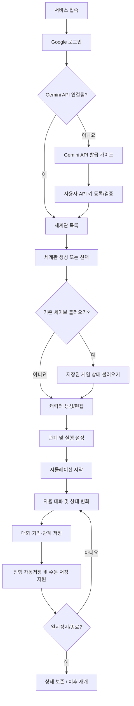

# AI Character World — 제품 요구사항 명세서 (PRD)

> **문서 상태:** 최종 확정 v1.2 (2026-10-27 설계 최종 승인 반영, §13 변경 이력 참고)  
> **설계 문서:** `docs/architecture.md`, `docs/database.md`  
> **프로젝트 성격:** RimTalk에서 영감을 받은 웹 기반 AI 캐릭터 자율 대화 시뮬레이터  
> **개발 목표:** 실제 서비스 MVP 구현과 Claude Code 학습 병행

## 1. 제품 개요

### 1.1 한 줄 소개

사용자가 세계관과 캐릭터를 만들면, 각 캐릭터가 **성격·목표·감정·관계·기억**에 따라 스스로 대화하고, 그 대화가 다음 이야기와 관계에 영향을 주는 웹서비스.

### 1.2 핵심 가치

- **창작:** 세계관, 등장인물, 성격을 직접 구성한다.
- **자율성:** 사용자가 대사를 일일이 입력하지 않아도 캐릭터들이 대화한다.
- **일관성:** 캐릭터의 정보와 성격, 이전 경험이 다음 대화에 반영된다.
- **변화:** 대화를 통해 감정·관계·기억이 누적된다.
- **비용 통제:** 사용자는 자신의 Gemini API 키로 직접 비용을 부담하며, 언제든 실행을 멈출 수 있다.

### 1.3 대상 사용자

- 세계관 및 캐릭터 창작을 즐기는 사용자
- AI 캐릭터의 상호작용을 관찰하고 싶은 사용자
- 자신의 API 키로 생성 비용을 관리하려는 사용자

### 1.4 범위의 명확한 경계

- **포함:** 텍스트 기반 자율 대화와 상태 변화, 웹 UI, 사용자별 저장 및 재개.
- **제외:** RimWorld 게임 연동, 2D 캐릭터 이동/물리 엔진, 사용자 없이 24시간 계속 돌아가는 시뮬레이션, 자체 LLM 학습.
- RimTalk의 아이디어에서 영감을 받되, 기존 모드의 코드·에셋·브랜드를 복제하지 않는다.

---

## 2. 확정된 제품 결정

| 항목 | 결정 |
|---|---|
| 서비스 형태 | 멀티유저 웹서비스 |
| 로그인 | **Google OAuth만** 지원 (이메일·비밀번호 로그인 제외) |
| AI 제공자 | **Google Gemini 우선** |
| 과금 | **BYOK** — 사용자 본인의 Gemini API 키 사용 |
| 서버 소유 API 키 | 사용자 실행에 사용하지 않음 (폴백 금지) |
| 실행 | **사용자 실행형(B)** — 시작/일시정지/종료 |
| 캐릭터 자율성 | **Level 2** — 대사 + 행동 의도 생성 |
| 캐릭터 | **세계관당 최대 6명**, 생성·편집·삭제 및 🎲 랜덤 생성 |
| 사용자 정의 설정 | **세계관 컨텍스트 무제한 저장**(글자 수 제한 없음, HTTP 요청 본문은 최대 10MB), **캐릭터별 컨텍스트 최대 300자**, 비공개 컨텍스트 없음 |
| 대화 엔진 | MVP **스토리 모드**(Gemini 1회 호출로 3~6턴 장면 생성), 향후 캐릭터별 **에이전트 모드** 확장 |
| 실시간 갱신 | **SSE**, 제어 명령은 일반 HTTP API |
| 실패 처리 | 실패 장면 건너뛰고 **실행 중 상태 유지**, 대화창 시스템 메시지 및 하단 HTTP 로그 표시. 관계·감정 변화량 초과는 상한으로 보정(clamp), 구조 오류·잘못된 참조는 장면 실패 |
| 연결 끊김 | 모든 SSE 연결이 끊기면 신규 Gemini 요청 **즉시 보류**, **60초 이내 재연결 시 자동 재개**, 60초 초과 시 `paused` 전환(재접속 후 사용자가 재개). 진행 중 요청은 완료 후 정상 처리 |
| 성별·나이 | 수동 지정 또는 자동/랜덤 설정 |
| 저장 | 세계관 데이터와 **게임 세이브 슬롯(저장/불러오기/덮어쓰기/삭제)** 분리, 1시간 자동 저장 지원. 사용자 슬롯 **세계관당 10개(수동 최대 5 + 자동 5 순환)**, 복구 지점은 별도 1개. 불러오기는 세계관·캐릭터 설정을 포함한 **전체 게임 상태**를 복원(Google 로그인 정보·Gemini API 키 제외)하고, 불러오기 전 진행 상태를 복구 지점으로 보존 |
| 대화 간격 | 이전 요청 완료 후 기본 **5초**, 느림 15초 / 보통 5초 / 빠름 1초 |
| 시뮬레이션 계속 실행 | 사용자가 종료할 때까지 진행하되 사용자 설정 API 사용량 상한과 서버 보호 정책 적용 |
| 사용량 한도 | **사용자 Gemini API 키(연결) 단위**로 일일 한도·백오프 관리, 일일 기준 **Asia/Seoul(KST)**. 한도 도달 시 `paused`. 키 교체 시 한도 설정·사용량 집계 유지, 백오프만 초기화. 세션별 사용량은 별도 기록 |
| 기록 및 삭제 | 캐릭터 삭제 후에도 과거 대사 보존(삭제된 캐릭터 표시), 기록은 사용자가 삭제 가능(현재 게임 기록만 삭제, 기존 수동 세이브는 유지) |
| 실행 중 설정 수정 | 저장 후 **다음 장면부터** 적용 |
| 초기화 | 세계관/캐릭터 기본 설정 유지, 진행 상태 선택 초기화. **`idle` 또는 `paused` 상태에서만** 허용 |
| 세계관 템플릿 | 무인도·판타지·우주선·학교·좀비 등 기본 템플릿 제공 |
| 개발 | Claude Code 학습을 병행, 로컬 서버에서 시작 |
| 목표 | MVP 검증 후 GitHub 및 공개 배포 |

---

## 3. 사용자 이용 흐름



**첫 이용 완료 조건:** 로그인 → 개인 Gemini API 키 연결 → 세계관 1개 생성 → 캐릭터 3명 생성 → 대화 시작 → 관계/기억 변화 확인 → 일시정지 → 재개.

---

## 4. 기능 요구사항

### FR-01. 인증 및 사용자 관리 — P0

- Google OAuth로 로그인/재로그인/로그아웃 가능.
- 최초 로그인 시 사용자 레코드 자동 생성.
- 이메일/비밀번호 가입, 비밀번호 재설정, 일반 소셜 로그인은 제공하지 않음.
- 사용자별 세계관과 API 연결 데이터는 서버에서 소유권 확인.
- 로그인하지 않은 사용자는 개인 데이터 페이지에 접근 불가.

**인수 조건:** 다른 사용자 ID를 전달해도 타인의 세계관·캐릭터·기록·API 설정을 읽거나 수정할 수 없다.

### FR-02. Gemini API 연결 및 발급 가이드 — P0

- `/guide/gemini`: Google AI Studio 이동 링크, API 키 발급 단계, 키 보관 주의사항, 무료/유료 및 제한 안내.
- `/settings/providers`: Gemini API 키 등록·연결 테스트·교체·삭제, 기본 모델 선택.
- 비밀 키는 로그, URL, 클라이언트 응답에 노출하지 않음.
- 서버에 저장할 경우 검증된 서버 측 암호화와 별도 암호화 키 관리 사용.
- 사용자 API 키가 없거나 사용 불가하면 실행 차단; 운영자 키로 대체하지 않음.
- 사용량 및 예상 비용을 표시하고 실제 과금 확인은 Google 측에서 하도록 안내.
- 모델별 무료 정책·요금·제한은 변경 가능하므로 가이드 내 공식 문서 링크 유지.

**인수 조건:** 유효하지 않은 키에 이해 가능한 오류를 표시하고, 다른 계정의 키가 사용되지 않는다.

### FR-03. 세계관 관리 — P0

- 세계관 생성·조회·수정·삭제.
- 필드: 이름, 소개, 시대/장소, 세계 규칙, 현재 상황(선택), **세계관 컨텍스트(worldContext)**, 공개 여부(기본 비공개).
- **세계관 컨텍스트는 사용자 입력 글자 수 제한 없이 저장**하고, 모든 장면 생성에 공통 맥락으로 반영한다.
- 글자 수 제한은 두지 않되, 전송 계층 보호를 위해 **HTTP 요청 본문은 최대 10MB**로 제한한다.
- 저장 용량 및 모델 컨텍스트 창은 무한하지 않으므로 AI 호출 시 토큰 예산에 맞춰 선별·요약할 수 있다. 원본은 그대로 유지하고, 사용자에게 누락·요약 가능성을 안내한다. 예산을 초과하면 해당 장면에 일부 내용이 반영되지 않았을 수 있음을 표시한다.
- 기본적으로 개인 소유이며 다른 사용자에게 보이지 않음.
- 삭제 전에 **해당 세계관의 모든 세이브 슬롯·진행 기록까지 삭제**됨을 경고하고 재확인한다.
- 신규 생성 시 **세계관 템플릿**(무인도 생존, 판타지 왕국, 우주선, 현대 학교, 좀비 아포칼립스)을 선택하면 미리 준비된 텍스트로 초안을 채우고 사용자 편집을 허용한다. 템플릿 자체에는 AI 호출을 사용하지 않는다.
- **세계관 관리와 게임 저장을 분리한다.** 세계관은 지속적인 설정·캐릭터 틀이고, 게임 세이브는 특정 시점의 이야기 진행 상태를 복원하는 데이터다.

**인수 조건:** 로그아웃 후 다시 로그인해도 세계관이 보존된다.

### FR-04. 캐릭터 생성 및 랜덤 — P0

- **세계관당 최대 6명**까지 캐릭터 생성/수정/삭제; 프런트엔드와 서버에서 생성 제한 검증.
- 필드: 이름, 성별, 나이, 성격 태그(권장 3~5개), 목표, **사용자 정의 캐릭터 컨텍스트(characterContext)**, **유년기·성년기 배경**(v1.5).
- **배경(v1.5, Phase 7-1)**: 고정 프리셋 44종(유년기 20·성년기 24, 등급 일반·특수·희귀) 중에서만 선택한다. 직접 입력·미설정 선택지는 없다. 유년기는 모든 캐릭터 필수, 성년기는 19세 이상 필수·18세 이하 설정 불가(클라이언트·서버 모두 검증). 랜덤은 등급 가중(60/30/10) 후 등급 내 균등이며 잠금과 연계한다(나이 규칙 우선). 배경은 과거 경험으로 AI 컨텍스트에 이름·설명이 전달되며 현재 성격·능력을 정하는 스탯이 아니다. 세이브에 포함된다.
- 캐릭터 편집 화면에서 캐릭터 컨텍스트를 직접 입력·수정하며 **최대 300자**를 프런트엔드 및 서버에서 검증한다. 실시간 글자 수 표시.
- **비공개 컨텍스트 입력 필드는 제공하지 않는다.** 기존 설정의 배경·말투·가치관 등은 공개 단일 컨텍스트에 담는다.
- 수정된 설정은 이미 진행 중인 요청이 아니라 **다음 대화 장면부터 반영**하며, 기존 대화·관계·기억은 기본적으로 유지한다.
- **성별과 나이**는 직접 입력 가능하고 비워둘 때 자동 설정 가능.
- 성격 태그는 사회성·감정·행동·도덕성·생활 태도·관계 성향 등으로 분류.
- 🎲 **전체 랜덤**: 이름·성별·나이·성격 등 자동 생성.
- 🎲 **항목별 랜덤**: 선택 항목만 재생성.
- **옵션 잠금**: 잠근 필드는 전체 랜덤에서도 유지.
- 기본 랜덤 생성은 사전 준비된 데이터/규칙 기반으로 처리하여 LLM 호출 없음.
- 가능하면 세계관 맥락에 맞는 이름/배경 템플릿을 사용하며, AI 배경 생성은 후속 기능.
- 내부 성격 수치: 외향성·친화성·성실성·정서 안정성·개방성(각 0~100). 태그와 수치 매핑 정책 명시.
- 선택된 성격은 실제 AI 컨텍스트 및 행동 경향에 반영.
- 캐릭터 삭제 시 이전 대화 메시지는 유지하고 **삭제된 캐릭터 표시명과 식별 정보를 보존**하여 과거 대사가 깨지지 않도록 한다. 삭제 캐릭터는 신규 장면 참가 대상에서 제외한다.

**인수 조건:** 전체 랜덤, 부분 랜덤, 잠금 유지가 동작하며 새 캐릭터 저장 후 재접속해도 설정이 동일하다.

### FR-05. 캐릭터 관계 및 감정 — P1 (MVP의 최소 구현 포함)

- **방향성 관계**: A→B와 B→A는 별개.
- 축: 호감도(affinity), 신뢰도(trust), 존경심(respect), 친밀도(familiarity).
- 값 범위: 호감도·신뢰도·존경심 **-100~100**, 친밀도 **0~100**.
- 캐릭터별 현재 감정/기분 상태 저장.
- 초기 관계는 기본값 또는 사용자 설정으로 시작.
- 대화 후 관계·감정 변화는 서버가 허용 범위를 검증하고 반영. 허용 범위를 넘는 변화량은 상한으로 보정(clamp)한다.
- 변화 이력 확인 가능(상세 시각화는 후속 단계).

**인수 조건:** 캐릭터 A가 B를 신뢰해도 B가 A를 동일하게 신뢰할 필요는 없으며, 변경 값은 유효 범위를 넘지 않는다.

### FR-06. 자율 대화 엔진 — P0

- 사용자가 시작 버튼을 눌렀을 때만 새로운 AI 대화를 생성.
- 서버가 **현재 세계 상태 → 참가자 선정 → 대화 동기 선정 → 컨텍스트 조합 → Gemini 호출 → 결과 검증 → 상태 반영** 순서를 관리.
- 대화 동기: 세계 이벤트, 관계, 캐릭터 목표 중 하나 이상.
- 반복적으로 같은 두 캐릭터만 선택되지 않도록 최근 대화 패널티와 다양성 부여.
- Gemini는 대사 및 행동 의도, 감정/관계 변화 *제안*을 구조화된 형식으로 반환.
- 서버는 스키마 검증, 캐릭터 ID·범위·권한·세계 규칙 검증을 통과한 결과만 반영. 구조 오류·유효하지 않은 참조는 장면 실패로 처리하고, 수치 범위 초과만 보정(clamp)한다.
- **MVP 스토리 모드:** Gemini API **1회 호출**로 기본 2~3명의 캐릭터가 참여하는 **3~6턴**의 짧은 장면을 생성하며 종료 조건을 적용. 캐릭터 6명이 매 장면 전원 등장하지 않아도 됨.
- 캐릭터 상태·기억·관계는 개별적으로 유지한다. **향후 에이전트 모드**(캐릭터별 개별 AI 호출)를 별도 대화 생성 전략으로 추가할 수 있게 인터페이스 분리.
- 비공개 컨텍스트는 없지만 캐릭터별 **경험·인지 범위가 다른 기억**은 유지한다. 단일 호출의 정보 누출 위험은 프롬프트 구성과 결과 검증으로 줄이되 완전한 비밀 보장은 약속하지 않는다.
- 중복 응답·네트워크 재시도에 의해 같은 장면이 이중 저장되지 않도록 설계.
- AI가 만든 대사는 **허구의 캐릭터 발화**임을 UI에서 분명히 구분.

**인수 조건:** 캐릭터 3명 환경에서 2개 이상의 장면이 생성되고, 장면별 화자·대사·의도가 저장된다. 실패 응답은 부분 상태를 망가뜨리지 않는다.

### FR-07. 실행 제어 및 사용량 관리 — P0

- **시작 / 일시정지 / 재개 / 종료** 지원.
- 일시정지는 **진행 중인 장면이 완료된 뒤** 반영한다. 종료·불러오기는 진행 중 요청의 취소를 시도하고, 상태 버전(stateVersion) 검증으로 이전 요청 결과의 커밋을 차단한다.
- 최초 기본 설정: 동시 API 요청 1개, 장면당 최대 턴, API 사용량 상한 및 요청 간격. **임의의 장면 수에 도달했다고 반드시 종료하지 않으며 사용자가 종료할 때까지 진행**할 수 있다.
- 장면 생성 간격은 **이전 API 요청 완료 후** 느림 15초 / 보통 5초(기본) / 빠름 1초로 선택한다. 오류 시 백오프 정책이 우선한다.
- 세션별 요청 수·입출력 토큰·예상 비용 표시.
- 사용자가 설정한 호출/토큰 한도 도달 시 다음 호출 차단, 실행 상태를 `paused`로 전환하고 한도 도달 안내. 이는 일반 대화 생성 오류를 건너뛰는 정책과 구분한다.
- 사용량 한도와 백오프는 **사용자 Gemini API 키(연결) 단위**로 관리한다. 일일 한도는 **Asia/Seoul(KST) 날짜** 기준으로 집계한다. 같은 키로 여러 세계관을 실행하면 한도와 백오프를 공유한다.
- Gemini API 키를 교체해도 사용자가 설정한 일일 한도와 사용량 집계는 초기화하지 않으며, 백오프 상태만 초기화한다.
- 세션(SimulationRun)별 요청 수·토큰 사용량은 키 단위 집계와 별도로 기록한다.
- **연결 끊김 정책:** 해당 세계관의 모든 SSE 연결이 끊기면 신규 Gemini 요청을 **즉시 보류**한다. **60초 이내 재연결**되면 자동으로 재개하고, **60초를 초과**하면 `paused`로 전환한다(재접속 후 사용자가 직접 재개). 이미 진행 중인 요청은 완료 후 정상 처리한다. 서버 비정상 종료 시에는 연결 끊김 감지에 최대 30초가 걸릴 수 있으며, MVP에서는 이 제한을 허용한다.
- 이미 전송된 요청은 취소해도 비용이 발생할 수 있음을 안내.
- **단일 세계관에 대한 중복 실행 방지**.
- 초기 로컬 구현은 단일 프로세스에서도 가능하나, 공개 서비스 전에는 서버 측 세션 상태/작업 소유권/타임아웃 처리를 검증해야 함.

**인수 조건:** 일시정지 후 다음 LLM 요청이 시작되지 않으며, 동일 세계관을 두 탭에서 열어도 중복 실행되지 않는다.

### FR-08. 캐릭터별 기억 — P1 (MVP의 최소 구현 포함)

- **단기 기억**: 최근 대화 몇 턴을 문맥에 포함.
- **장기 기억**: 중요한 사건/약속/고백/갈등 등 선별 저장.
- **인물 기억**: 특정 상대에 대한 개별 인식.
- 기억에는 `소유 캐릭터`, `출처 사건/대화`, `중요도`, `생성 시점` 등을 저장.
- **정보 비대칭 보장**: 직접 경험·관찰·전해 듣지 못한 비밀은 해당 캐릭터의 컨텍스트에 포함하지 않음.
- 최초에는 PostgreSQL의 명시적 조회 규칙으로 구현하고, 규모 확대 시 pgvector 검토.
- 오래된 정보와 현재 세계 상태가 충돌하면 현재 확정 상태를 우선.

**인수 조건:** A와 B가 공유한 비밀이 목격하지 않은 C의 프롬프트/기억에 자동 포함되지 않는다.

### FR-09. 시뮬레이션 관찰 UI — P0

- 캐릭터 목록/현재 기분/현재 관계 요약 표시.
- **SSE로 대화 메시지·관계 변화·실행 상태·API 요청 로그를 실시간 전송**한다. 사용자 시작/일시정지/종료 등 명령은 별도 HTTP API.
- 대화 생성 실패 시 대화창에 **캐릭터 발화와 구분되는 시스템 오류 메시지** 표시. 실패 장면은 건너뛰고 시뮬레이션을 계속 실행하며 **일시정지로 전환하지 않는다**. 시스템 메시지는 캐릭터 대사와 분리해 저장(SystemNotice)하며 게임 세이브에 포함하지 않는다. 시스템 메시지는 **90일**, 실시간 이벤트 기록(SSE 재전송용)은 **24시간** 보관한다.
- 실패한 장면의 대사·관계·기억은 반영하지 않으며 자동 재생성하지 않는다. 실패 진단 로그는 별도 기록.
- **대화 영역 하단 접기·펼치기 가능한 API 로그 탭** 배치: 요청 시작·응답·실패, HTTP 상태, 응답 시간, 사용 모델, 오류 코드/메시지, 요청 수·성공 수·실패 수 표시.
- 네트워크 오류는 HTTP 코드 없이 `NETWORK_ERROR`로 표시; HTTP 200 후 스키마 검증 실패는 별도의 `VALIDATION_ERROR`로 구분.
- API 키·Authorization 헤더·세계관/캐릭터 컨텍스트 원문은 API 로그에 저장하거나 노출하지 않는다. API 로그는 **30일** 보관 후 삭제하며, 사용자가 직접 삭제할 수 있다.
- 장면 시작·종료 및 실행 상태, 생성 중 표시.
- 시작·일시정지·재개·종료 버튼.
- 과거 대화 이력 탐색 및 사용자 요청에 따른 기록 삭제. 기록 삭제는 **현재 게임의 기록만** 삭제하며 기억·관계·감정 값과 기존 수동 세이브에는 영향을 주지 않는다. 삭제 확인창에서 기존 세이브에는 해당 기록이 남아 있을 수 있음을 안내한다.
- **진행 초기화**: 세계관과 캐릭터 기본 프로필은 유지한 채 대화·기억·관계 변화·감정 상태를 선택적으로 초기화. 실행 중 초기화는 허용하지 않으며, **`idle` 또는 `paused` 상태에서만** 진행 중인 장면이 완전히 종료된 뒤 수행한다. 확인 대화상자를 띄운다.
- 시뮬레이션 화면에서 **게임 저장 / 불러오기 / 덮어쓰기 / 삭제**를 실행할 수 있도록 한다.
- 모바일/데스크톱 반응형.

**인수 조건:** 사용자가 대화 진행 상태를 이해할 수 있고, 새로고침 후 기록이 사라지지 않는다.

### FR-12. 게임 세이브 및 불러오기 — P0

**세계관(World)과 세이브(SaveGame)는 다르다.** 세계관은 사용자가 편집하는 공통 창작 설정과 캐릭터 프로필을 관리하며, 세이브는 그 세계에서 특정 시점까지 진행된 **게임 상태의 스냅샷**을 의미한다.

- **새 저장:** 현재 게임 진행 상태를 이름 붙인 **수동 세이브 슬롯**으로 생성한다. 수동 슬롯은 **세계관당 최대 5개**다(가득 차면 새 저장을 거부하고 덮어쓰기·삭제를 안내). 슬롯에는 마지막 저장 시각, 세계관 이름, 진행 장면 수 및 캐릭터 수 등을 표시한다.
- **불러오기:** 저장된 슬롯을 선택하면 해당 시점의 **세계관·캐릭터 설정을 포함한 전체 게임 상태**(대화 이력, 캐릭터 관계·감정, 기억, 세계 이벤트, 실행 설정 및 진행 위치)를 복원한다. Google 로그인 정보와 Gemini API 키는 복원 대상이 아니다. 불러오기 전 현재 진행 상태는 **복구 지점(자동저장)으로 보존**한다. 연속으로 불러오는 동안 게임 상태 변경이 없으면 최초 복구 지점을 유지하고, 불러오기 이후 세계관·캐릭터 설정 수정이나 대화 기록 삭제 등 변경이 있었다면 다음 불러오기 전에 그 변경 상태를 복구 지점으로 보존한다. 불러오기는 **중지(`idle`) 상태이고 진행 중 장면이 없을 때만** 가능하다(실행·일시정지 중이면 먼저 종료하도록 안내). 그 전에 시작된 요청의 늦은 결과는 반영하지 않는다. **불러온 직후 상태는 중지 상태**이며 사용자가 다시 시작해야 AI 호출이 재개된다.
- **덮어쓰기:** 기존 슬롯에 현재 진행 상태를 저장한다. 해당 슬롯의 이전 내용이 대체된다는 확인 절차를 제공한다.
- **삭제:** 선택한 수동 세이브 슬롯을 삭제한다. 확인 절차를 제공하고, 다른 슬롯 및 원본 세계관은 유지한다.
- **자동저장:** 시뮬레이션이 **실행 중(`running`)일 때 1시간마다**(마지막 자동 저장 성공 기준, 시작·재개 직후에는 저장하지 않음) 마지막으로 확정된 상태를 자동 저장 슬롯 5개(Auto Save 1→2→3→4→5→1 순환)에 저장한다. 이름은 `{세계관 제목} - Auto Save {번호}`이며 사용자가 이름을 바꾸거나 덮어쓰지 않는다. 수동 세이브 슬롯을 덮어쓰지 않고, 실패하면 기존 스냅샷을 유지한다. 자동 저장도 수동 저장처럼 불러올 수 있다. 확정된 진행 상태는 장면마다 DB에 커밋되므로 브라우저 종료·서버 재시작 후에도 그대로 이어진다.
- **복구 지점:** 불러오기·초기화로 진행 상태가 교체되기 직전의 상태를 **별도 복구 지점 1개(세계관별)**에 보존한다. 사용자 슬롯 10개에 포함하지 않으며, 별도 '복구' 영역에서 불러올 수 있다.
- **데이터 일관성:** 대화·감정·기억·관계·이벤트 및 체크포인트가 **한 시점의 일관된 상태**를 나타내도록 트랜잭션/스냅샷 버전 기반으로 저장한다. 저장 중인 작업과 호출 결과가 엇갈리지 않도록 **장면 경계에서 저장**하고, 저장 도중에는 동일 세계관에 대한 중복 저장/불러오기/실행을 방지한다.
- **세계관/캐릭터 편집과의 관계:** 세이브에는 해당 시점의 **캐릭터 기본 정보·성격·컨텍스트, 세계관 컨텍스트도 포함**해 과거 게임을 일관되게 재현한다. 불러오기는 *활성 진행 상태와 세계관·캐릭터 설정*에 해당 스냅샷을 적용하고, 별도로 관리되는 다른 저장 슬롯은 변경하지 않는다. 따라서 세이브 이후 수정한 설정이나 추가한 캐릭터는 불러오기 후 되돌아가며, 불러오기 직전 복구 지점(자동저장)에서 되찾을 수 있다. 세계관 편집 중의 미저장 변경은 불러오기 전에 저장/폐기 여부를 확인한다.
- **대화 기록 삭제와의 관계:** 대화 기록 삭제는 현재 게임의 기록에만 적용되며 기존 수동 세이브는 그대로 유지한다.
- **API 키 미포함:** 세이브에는 Gemini API 키·OAuth 토큰·인증 세션·복호화 비밀을 포함하지 않는다. 현재 로그인한 사용자의 유효한 API 연결을 이용해 재개한다.
- **사용자 격리:** 본인 소유 세계관의 슬롯만 조회·저장·불러오기·삭제 가능. 세이브는 서버 측에 보관해 다른 기기에서도 사용할 수 있게 한다.
- **자동저장 복구:** 브라우저 종료/새로고침 후 마지막 확정 상태에서 이어가거나, 자동·수동 슬롯에서 재개할 수 있다. 저장 내용이 없는 경우 신규 게임 상태에서 시작한다.
- **초기화:** 사용자가 대화/기억/관계/감정을 선택해 초기화하더라도 **기존 수동 세이브는 유지**된다. 초기화는 `idle` 또는 `paused` 상태에서만 가능하다. 초기화 직전 상태는 복구 지점으로 보존되며, 초기화 후 다음 확정 장면부터 새 자동저장 상태로 갱신한다.
- **게임 저장/불러오기/삭제 UI:** 시뮬레이션 상단 `게임` 메뉴 또는 `저장 관리` 모달에 **새 저장, 불러오기, 덮어쓰기, 이름 변경, 삭제, 복구 지점 복원**을 제공한다. 수동·자동 저장은 하나의 목록(마지막 저장 시각 최신순)에 구분 배지와 함께 표시한다.

**인수 조건:** 3개 장면 진행 → 수동 저장 A → 2개 장면 추가 진행 → A 불러오기 → 이전 3개 장면 시점의 대화·기억·관계·감정이 정확히 복원된다. A 덮어쓰기와 삭제 동작, 자동저장 복구, 타인 슬롯 접근 차단도 확인한다.

### FR-10. 이벤트 개입 — P2

- 사용자가 세계에 사건을 추가해 다음 대화의 동기를 제공.
- 관찰자 명령과 캐릭터가 직접 들은 말을 구분.
- 위험하거나 불가능한 세계 상태 변경은 서버 검증 후 제한.

### FR-11. 체험 모드 — P2

- API 키 없이 **미리 저장한 샘플 대화**를 재생.
- 실제 LLM 생성이 아님을 명시.
- 체험 이후 Gemini 연결 가이드로 이동.

---

## 5. 캐릭터 시뮬레이션 동작 규칙

### 5.1 세계 상태와 AI의 책임 분리

| 서버가 최종 관리 | LLM이 제안 |
|---|---|
| 캐릭터 존재/ID·공개 정보 | 대사, 말투 |
| 현재 세계 규칙과 사실 | 행동 의도 |
| 관계·기억의 유효성 | 감정 변화 후보 |
| 실행 상태·호출 상한 | 관계 변화 후보 |
| 캐릭터가 아는 정보의 범위 | 기억할 만한 사건 후보 |

### 5.2 단일 장면 생성 흐름

```text
세션 실행 가능 여부 확인
  ↓
인물/이벤트/목표 기반 장면 후보 산출 (비LLM)
  ↓
참여 인물 선정 및 최근 대화 중복 회피
  ↓
Context Builder: 세계관 컨텍스트(공통) + 캐릭터 컨텍스트(각 최대 300자) + 성격/목표 + 관련 기억/관계 + 최근 대화
  ↓
해당 사용자 Gemini API 키로 호출
  ↓
구조화 응답 파싱 / Zod 검증
  ↓
세계 규칙·비밀 접근·관계 변화 범위 검증
  ↓
DB 트랜잭션으로 장면/대사/이벤트/관계/기억 기록
  ↓
성공: 대화/상태와 API 로그를 SSE 전송 → 다음 장면 예약
실패: 대화창 시스템 메시지 + API 오류 로그를 SSE 전송 → 상태 변경 없이 다음 장면 예약
```

### 5.3 초기 가드레일(조정 가능)

- 하나의 장면에 참여하는 캐릭터: 기본 2~3명.
- 한 장면 최대 대사 턴: 기본 6턴.
- 세션 최대 장면: **고정 종료 한도 없음**(사용자 종료까지). 대신 사용자 API 키 단위의 일일 호출/토큰 상한(KST 기준) 및 호출 속도 안전장치 적용.
- 동시 AI 호출: 세계관당 기본 1개.
- 감정/관계 변화량: 장면당 상한 **관계 축별 ±5, 감정 강도 ±20**(확정). 상한 초과 제안은 상한으로 보정(clamp)한다.
- 대화가 반복되거나 결론 없는 호응만 이어질 때 장면 종료/재선정.
- **개별 장면 실패 시 중단/일시정지/자동 재시도 없이 건너뛰고 계속 진행.** 다만 429·키 오류 등 지속 오류에서는 백오프 및 호출 차단 회로를 적용해 무한 실패 루프를 막는다. 차단은 실행 상태 `paused` 전환과 별개이며 새 요청은 보호 정책에 따라 제한됨.

### 5.4 Level 2 범위

캐릭터가 **자율적으로 발언하고 행동 의도를 제안**할 수 있지만, 파일 시스템 접근·임의의 코드 실행·외부 서비스 호출 등은 캐릭터에게 부여하지 않는다. 독립적인 도구 실행형 에이전트(Level 3)는 MVP 범위 밖이다.

---

## 6. 화면 및 URL 초안

| 화면 | 경로 | 주요 기능 |
|---|---|---|
| 랜딩 | `/` | 서비스 설명·로그인 유도 |
| 로그인 | `/login` | Google로 시작하기 |
| Gemini 발급 가이드 | `/guide/gemini` | 발급/주의사항/공식 링크 |
| AI 설정 | `/settings/providers` | 개인 키 연결, 검증, 모델 선택 |
| 세계관 목록 | `/worlds` | 생성, 선택, 삭제, 세계관별 저장 슬롯 확인 |
| 세계관 생성 | `/worlds/new` | 배경, 규칙, **세계관 컨텍스트(무제한 저장)**, 현재 상황 |
| 세계관 설정/편집 | `/worlds/[worldId]/settings` | 세계관 컨텍스트 및 공통 규칙 수정 |
| 세계관 상세 | `/worlds/[worldId]` | 요약, 캐릭터 진입 |
| 캐릭터 목록 | `/worlds/[worldId]/characters` | 목록·관리 |
| 캐릭터 생성 | `/worlds/[worldId]/characters/new` | 성격, 성별, 나이, 🎲 |
| 캐릭터 상세·편집 | `/worlds/[worldId]/characters/[characterId]` | 성격 및 **캐릭터 컨텍스트(300자)** 수정, 기억/관계 요약 |
| 시뮬레이션 | `/worlds/[worldId]/simulation` | 실행 제어·자율 대화·오류 시스템 메시지·**하단 API 로그 탭**, 게임 저장·불러오기·덮어쓰기·삭제·초기화 |
| 게임 저장 관리 | `/worlds/[worldId]/saves` | 수동 슬롯·최신 자동저장, 생성/불러오기/덮어쓰기/삭제 |
| 대화 기록 | `/worlds/[worldId]/history` | 장면·대사 이력 |
| 관계 보기 | `/worlds/[worldId]/relationships` | 관계 변화 (P1) |
| 기억 보기 | `/worlds/[worldId]/memories` | 기억 기록 (P1) |

---

## 7. 데이터 모델 초안

```text
User
 ├── Account / Session (Google OAuth)
 ├── AiProviderConnection (Gemini, encrypted credential, 일일 한도·백오프)
 │    └── ApiUsageDaily (키 단위 일일 사용량, KST 기준)
 └── World
      ├── worldContext (원본 무제한 입력)
      ├── Character
      │    ├── characterContext (최대 300자)
      │    ├── PersonalityProfile (성격 태그 + Big Five 수치)
      │    ├── EmotionState (현재 감정)
      │    └── CharacterMemory (소유 캐릭터별 기억)
      ├── RelationshipBaseline (초기 관계 설정)
      ├── GameState (활성 진행 상태, stateVersion)
      │    ├── ConversationScene (진행 이력)
      │    │    └── Message (캐릭터 발화)
      │    ├── RelationshipState (fromCharacter → toCharacter) + 변화 이력
      │    └── WorldEvent
      ├── SaveGame (수동 최대 5개 + 자동 5개 순환 + 복구 지점 1개)
      │    └── GameSnapshot (세계/캐릭터 설정 및 진행 상태; schemaVersion·생성시각)
      ├── SimulationRuntime (실행 상태, DB lease, SSE 연결 보류)
      ├── SimulationRun (시작~종료 1회 실행 기록, 세션별 사용량)
      ├── SystemNotice (시스템 오류 메시지, 세이브 제외)
      └── ApiRequestLog (HTTP/SDK 요청 상태, 응답시간, 오류, 토큰; 30일 보관)
```

상세 설계는 `docs/database.md`를 따른다.

**원칙:** 모든 세계관 소유 리소스는 `worldId`와 사용자 소유권을 따라 검증한다. 대화 저장과 상태 변화는 가능한 한 트랜잭션으로 처리한다. 관계는 방향성을 가지며, 기억은 캐릭터별 접근 범위를 가진다.

---

## 8. 비기능 요구사항

### 8.1 보안·프라이버시

- Google OAuth의 state/redirect/session 보호는 검증된 인증 라이브러리 사용.
- API 키는 브라우저에 다시 노출하지 않으며 서버 저장 시 암호화. 로깅·에러 리포팅에서 키 마스킹.
- 인증·인가 검사는 UI가 아닌 **서버의 모든 데이터 접근 경로**에서 수행.
- HTTPS, CSRF 관련 설정, 요청 제한, 키 교체/삭제, 세션 만료 고려.
- 입력된 세계관/대화 내용을 **명령이나 상위 시스템 지침으로 신뢰하지 않음**(프롬프트 인젝션 완화).
- 외부 LLM 제공자에 전송되는 컨텍스트 범위를 사용자에게 알림.
- 계정 및 세계관 삭제 시 관련 데이터 제거 정책 마련.

### 8.2 안정성

- **장면 단위 자동 재시도 없음:** 실패는 대화창과 API 로그에 표시하고 건너뛰며 실행 상태 유지.
- 연속 실패·429·인증 오류 등 반복 요청 위험이 있는 경우에는 백오프 또는 호출 차단(서킷 브레이커)으로 과도한 요청을 억제한다. 이것은 시뮬레이션 일시정지 명령과 구분한다.
- 오류 중에도 세션 및 장면 상태가 복구 가능해야 함.
- DB 기록 중복 방지, 장시간 멈춘 실행의 타임아웃 처리.
- 저장/불러오기/초기화는 활성 실행과 경합하지 않도록 장면 경계에서 동기화하고, 세이브의 버전·유효성 검사 및 원자적 커밋을 적용.
- 개발 중 Mock Gemini 응답으로 대부분의 엔진 테스트 실행 가능.
- **서버 재시작 시 실행 상태 복구**와 **중복 API 호출 방지**(동일 세계관에 대한 이중 호출 0건)를 자동화 테스트로 검증한다.

### 8.3 비용 투명성

- 사용자 키를 사용하므로 LLM 요금은 키 소유자의 Google 계정/프로젝트 정책을 따름.
- **앱의 자체 제한은 예상 비용 통제 수단이며 Google 측 청구 상한을 보장하지 않음.**
- 모델별 가격·무료 한도는 변경 가능하므로 하드코딩된 '영구 무료' 문구 금지.
- 서비스 운영자의 서버·DB·트래픽 비용은 별도.

### 8.4 성능·사용성

- 초기 목표는 작은 규모의 세계관(예: 캐릭터 최대 6명)을 부드럽게 다루는 것.
- LLM 응답 지연 중에는 상태를 표시하고 중복 실행 버튼을 비활성화.
- 접근 가능한 폼·키보드 조작·반응형 레이아웃 제공.

---

## 9. 기술 및 개발 도구(초기 권장)

| 구분 | 선택 방향 |
|---|---|
| 웹 앱 | Next.js, React, TypeScript |
| 스타일/UI | Tailwind CSS, shadcn/ui |
| 인증 | Better Auth + Google OAuth |
| DB/ORM | PostgreSQL + Prisma |
| AI | Google Gen AI SDK (Gemini API) |
| 검증 | Zod |
| UI 상태 | 필요 시 Zustand |
| 실시간 표시 | **SSE 확정** (대화, 상태, API 로그); 제어는 HTTP API |
| 로컬 인프라 | Docker Compose |
| 테스트 | Vitest + Playwright |
| 개발 보조 | Claude Code, `CLAUDE.md`, Rules, Skills, Subagents, Hooks |
| 후속 확장 | Redis/BullMQ, 별도 Worker, 다중 AI 제공자 |

**배포 주의:** Vercel에 Next.js UI/API를 배포하더라도, 장시간 실행되는 시뮬레이션 루프는 서버리스 요청 수명에 의존하지 않도록 별도 실행 구조가 필요할 수 있다.

---

## 10. 개발 로드맵

| 단계 | 목표 | 완료 산출물 |
|---|---|---|
| Phase 1 | PRD/아키텍처/프로젝트 초기화 | 문서, GitHub 저장소, Next.js, Claude Code 규칙 |
| Phase 2 | DB 및 Google 로그인 | Prisma 스키마, Google OAuth, 사용자 격리 |
| Phase 3 | Gemini BYOK/가이드 | 키 연결·검증·삭제, 가이드 페이지 |
| Phase 4 | 세계관·캐릭터 | 세계관 템플릿, 컨텍스트 입력/수정, 캐릭터 6명 제한, 성격 선택, 🎲 랜덤/잠금 |
| Phase 5 | 자율 대화 엔진 | **스토리 모드** 장면 생성, 전략 인터페이스, 실패 장면 건너뛰기 |
| Phase 6 | 관계·기억 | 상태 변경, 캐릭터별 기억, 정보 비대칭 |
| Phase 7 | 시뮬레이션 UI 및 게임 저장 | SSE, 실행 제어, 하단 API HTTP 로그, 오류 메시지, **수동 저장/불러오기/덮어쓰기/삭제, 자동저장, 진행 초기화** |
| Phase 8 | 안정화 | 권한·비용·실패 복구·E2E 테스트 |
| Phase 9 | 배포 | CI, 운영 DB/비밀 관리, 웹 배포 |

**개발 반복:** 설계 → Claude Code Plan Mode → 구현 → 코드 검토 → 로컬 검증 → 테스트 → Git Commit.

---

## 11. MVP 승인 시나리오

1. 사용자가 Google 계정으로 로그인한다.
2. Gemini API 발급 가이드를 보고 자신의 키를 등록한다.
3. 세계관 하나를 만들고 **글자 수 제한 없는 세계관 컨텍스트**를 저장한다.
4. 서로 다른 성격의 캐릭터 3명을 생성하고 🎲 랜덤/잠금 기능을 테스트한다. **캐릭터 컨텍스트 300자 제한**, 편집 및 **7번째 캐릭터 생성 차단**을 확인한다.
5. **시작** 버튼을 누르면 세계관/캐릭터 컨텍스트를 반영한 **스토리 모드 3~6턴 장면**이 생성된다.
6. 대사뿐 아니라 행동 의도와 관계/기분 변화가 반영된다.
7. 중요한 사건이 관련 캐릭터에게만 기억되며, 모르는 인물은 그 비밀을 자동으로 알지 못한다.
8. **일시정지**하면 다음 AI 호출이 발생하지 않는다.
9. **재개**하면 기존 대화·기억을 반영해 다음 장면이 만들어진다.
10. 로그아웃 후 재접속해도 세계관과 대화 기록이 남아 있다.
11. Gemini 오류를 의도적으로 발생시키면 **대화창에 시스템 오류 메시지**, **하단 API 로그에 HTTP 상태·응답 시간·실패 사유**가 나타나며 실패한 장면은 **멈추지 않고 건너뛴다**.
12. SSE로 API 로그와 대화가 실시간 갱신되며, 키 누락·할당량 초과·API 오류·다중 탭·타인 리소스 접근 상황이 안전하게 처리된다.
13. 장면 생성 간격을 15/5/1초로 변경하고, 사용자 종료 전까지 실행하되 사용량 한도를 준수한다.
14. **수동 저장 A → 추가 진행 → A 불러오기**가 가능하고, 관계·기억·대화·컨텍스트가 저장 당시로 복원된다. 불러오기 직후 자동으로 Gemini API를 호출하지 않는다.
15. **수동 슬롯 덮어쓰기/삭제**, 최신 자동저장 복구, 진행 초기화 후 기존 수동 슬롯 유지, 타인 세이브 접근 차단이 검증된다.
16. 캐릭터를 삭제하더라도 기존 대화에서 화자 정보가 유지되고, 다음 장면 참가 대상에서는 제외된다.

---

## 12. 확정된 운영 기본값 및 추후 구현 검증

| 쟁점 | 초기 제안 | 확정 시점 |
|---|---|---|
| 세계관당 캐릭터 상한 | **최대 6명 확정** | 확정 |
| 연령 랜덤 범위 | 세계관에 맞는 성인 연령 기본 범위, 직접 입력 허용. 템플릿 도입 전 공통값 20~59세 | 확정 (Phase 4-2) |
| 성별 선택지 | 남성/여성/논바이너리/직접 입력/미지정 | 확정 |
| AI 모델 기본값 | 개발 시점의 사용 가능한 Gemini Flash 계열 모델 검증, Phase 3 실제 API 테스트 후 확정 | Phase 3 |
| 실행 단위 | **스토리 모드**: 1회 API 호출로 3~6턴 장면 생성; 에이전트 모드는 후속 | 확정 |
| 실시간 갱신 | **SSE 확정**, 명령은 HTTP API | 확정 |
| API 키 저장 방식 | 서버 암호화 저장 우선, 보안 설계 검토 | Phase 3 |
| 공개 범위 | MVP는 개인 비공개 세계관만 | 확정 |
| 사용량 한도 도달 시 상태 | `paused` 전환 + 안내 | 확정 |
| 사용량 한도 단위·기준 | 사용자 Gemini API 키 단위, 일일 기준 Asia/Seoul(KST) | 확정 |
| 세이브 슬롯 | 세계관당 수동 최대 5개 + 자동 5개(1시간 간격 순환), 복구 지점 별도 1개 | 확정 (v1.4) |
| 관계 값 범위 | 호감도·신뢰도·존경심 -100~100, 친밀도 0~100 | 확정 |
| API 로그 보관 | 30일 | 확정 |
| HTTP 요청 본문 | 최대 10MB (세계관 컨텍스트 글자 수 제한 없음) | 확정 |
| 연결 끊김 | 즉시 보류, 60초 이내 재연결 시 자동 재개, 초과 시 `paused`. 서버 비정상 종료 시 감지 최대 30초 지연 허용(MVP) | 확정 |
| 연속 불러오기 복구 지점 | 변경 없으면 최초 복구 지점 유지, 변경 있으면 다음 불러오기 전 변경 상태로 교체 | 확정 |
| 장면당 변화량 상한 | 관계 축별 ±5, 감정 강도 ±20 | 확정 |
| 이벤트·시스템 메시지 보관 | 실시간 이벤트 기록 24시간, SystemNotice 90일 | 확정 |
| 토큰 예산 | Phase 3 실제 API 테스트 후 확정 | Phase 3 |
| 부적절한 콘텐츠 대응 | 사용자 신고·차단·모델 정책 및 게시 정책 검토 | 공개 전 |

### 운영 기준 추가 확정

- 대화 간격: 느림 15초, 보통 5초(기본), 빠름 1초. **이전 호출 완료 후** 대기 시간을 잰다.
- 대화 참여자: 장면별 자동 선정, 기본 2~3명.
- 종료: 사용자가 종료할 때까지 진행. 사용량 한도·브라우저 연결 중단·보호 정책은 우선 적용.
- 캐릭터 삭제: 과거 대화는 유지하고 화자 삭제 표시; 향후 대화에서는 제외.
- 대화 기록: 세계관별 서버 저장, 사용자가 삭제 가능.
- 설정 변경: 진행 중 편집 가능, 다음 장면부터 적용.
- 진행 초기화: 선택적 대화·기억·관계 변화·감정 초기화; 캐릭터/세계관 기본 설정 및 수동 세이브 유지. `idle`/`paused` 상태에서만 허용.
- 템플릿: 무인도 생존, 판타지 왕국, 우주선, 현대 학교, 좀비 아포칼립스.
- 저장: **수동 최대 5개 + 자동 5개(1시간 순환) + 복구 지점 1개(세계관별)**; 불러오기는 중지 상태에서만, 설정 포함 전체 게임 상태 복원, 불러오기 전 상태는 복구 지점으로 보존, 불러오기 후 정지 상태로 복원.
- 연결 끊김: 모든 SSE 연결이 끊기면 신규 요청 즉시 보류, 60초 이내 재연결 시 자동 재개, 초과 시 `paused`. 진행 중 요청은 완료 후 정상 처리.
- 사용량: API 키 단위 일일 한도(KST), 한도 도달 시 `paused`, 키 교체 시 집계 유지·백오프만 초기화.

> **문서 활용:** 아키텍처는 `docs/architecture.md`, 데이터 모델은 `docs/database.md`를 따른다. 구현 중 변경 시 PRD의 결정 사항 및 인수 조건과 두 설계 문서를 함께 갱신한다.

---

## 13. 변경 이력

| 버전 | 날짜 | 내용 |
|---|---|---|
| v1.0 | — | 최초 확정 |
| v1.1 | 2026-10-27 | 기술 결정 반영: 초기화 허용 상태(`idle`/`paused`), 불러오기 시 설정 포함 전체 복원 및 복구 지점 보존, 대화 기록 삭제 범위, 데이터 모델(ConversationScene→GameState, SimulationSession→SimulationRun, SystemNotice 분리), 키 단위 사용량·KST 기준·키 교체 정책, HTTP 본문 10MB, 기본값(한도 도달 시 `paused`, 슬롯 20개, 로그 30일, 관계 범위), SSE 연결 끊김 정책, clamp/장면 실패 기준, 일시정지·종료·불러오기 시 진행 중 요청 처리 |
| v1.2 | 2026-10-27 | 설계 최종 승인: 연속 불러오기 복구 지점 규칙, 서버 비정상 종료 시 SSE 감지 30초 지연 허용 및 재시작 복구·중복 호출 방지 테스트, 변화량 상한(관계 ±5·감정 ±20), 보관 기간(이벤트 24시간·SystemNotice 90일), 토큰 예산·기본 모델 Phase 3 확정 |
| v1.3 | 2026-10-28 | 캐릭터 랜덤·자동 나이 공통 범위 20~59세 확정(Phase 4-2) |
| v1.4 | 2026-10-28 | 세이브 슬롯 정책 변경(Phase 6, 사용자 확정): 수동 20개 → 수동 5 + 자동 5(실행 중 1시간 간격, Auto Save 1~5 순환), 장면 단위 자동저장 대신 시간 단위 자동 저장, 복구 지점은 별도 1개(슬롯 10개 미포함). 불러오기는 `idle`·진행 중 장면 없음일 때만 허용 |
| v1.5 | 2026-10-28 | 캐릭터 유년기·성년기 배경 고정 프리셋 44종 추가(Phase 7-1): 선택 필수 규칙(유년기 필수, 성년기 19세 이상 필수·18세 이하 불가), 등급 가중 랜덤, AI 컨텍스트 반영, 스냅샷 v2(v1 읽기 호환) |
